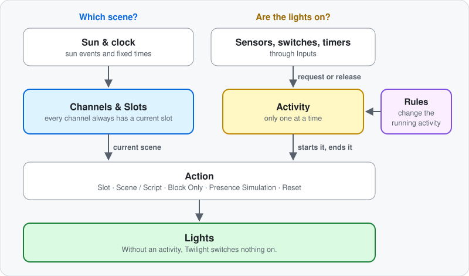

# How Twilight Works

The [README](README.md) explains each feature on its own. This page shows how they fit together: who decides what your lights do, what takes priority, and why a light sometimes behaves differently from what you expected.

For ready-made setups, see the [Example Configurations](EXAMPLES.md).

## Contents

- [The core idea: the schedule picks, an activity switches](#the-core-idea-the-schedule-picks-an-activity-switches)
- [What starts and ends an activity](#what-starts-and-ends-an-activity)
- [Only one activity at a time](#only-one-activity-at-a-time)
- [What happens at a slot change](#what-happens-at-a-slot-change)
- [What Rules change](#what-rules-change)
- [When someone switches a light directly](#when-someone-switches-a-light-directly)
- [After a restart](#after-a-restart)

---

## The core idea: the schedule picks, an activity switches

  

Twilight separates two questions:

- **Which scene?** The slots answer this. Every channel always has a current slot, and the sun or the clock moves it on, whether a light is on or not.
- **Are the lights on at all?** An activity answers this. While no activity runs, Twilight switches nothing on. A slot on its own never turns a light on.

A typical evening in the living room:

1. It is 19:00, the current slot is Civil dusk, and the lights are off. Nothing happens by itself.
2. You walk in. The motion input requests the Motion activity, and its **Slot** action plays the Civil dusk scene right away.
3. You stay. Nautical dusk starts, and the lights that are on fade to the new scene.
4. You leave. The timer runs out, and the **Turn Off** release action switches the lights off.
5. The slots keep moving in the background, and the next motion plays whichever scene is current by then.

---

## What starts and ends an activity

Inputs only ever request or release an activity. What happens to the lights is up to the activity.

| Input | Requests the activity | Releases it |
|---|---|---|
| **Motion** | On motion, if the [brightness check](README.md#brightness-check-for-motion) passes | Never — a motion sensor going quiet says nothing about the room, so the timer ends the activity |
| **Binary** | When it turns on | When it turns off |
| **Event** | On a matching event | Never |
| **Timer** | At its daily time | Never |
| **Button (Click)** | On every click | Never |
| **Button (Toggle)** | When switched on | When switched off |

An activity ends in one of these ways:

| What happens | Result |
|---|---|
| **The timer runs out** | Twilight first checks whether a triggering input is still active: a motion sensor still on (and passing the brightness check), a binary input or a toggle button. If so, the timer starts over at its full duration. If not, the activity ends. |
| **A binary input or toggle button turns off** | The activity ends, unless another of its inputs still holds it. |
| **Another activity takes over** | The new activity's action decides what the lights do. The old activity's release action does not run. |
| **A Reset activity runs** | All lights in the area and the area's enabled channels turn off, plus the running activity's **Turn-Off Entities**. With **Turn-Off Entities only**, just the Reset's own list turns off. No activity is running afterwards. |

An activity without **Enable Auto-Expire** has no timer. Started by motion, an event, a timer or a click, it runs until another activity takes over or a Reset ends it.

When an activity ends on its own, its **Release Action** decides what comes next:

| Release Action | Lights |
|---|---|
| **Turn Off** | Switch off, fading over **Transition Off** if it is set. |
| **Switch to Activity** | The chosen activity takes over, as if it had been started, with its own action and timer. Its release action decides what comes after it. Lights it does not control stay as they are. |
| **No Light Action** | Stay as they are and no longer follow the slots. |

---

## Only one activity at a time

An area runs exactly one activity. A new request displaces the current one — with two exceptions:

- **Input Suppression:** the running activity can ignore chosen inputs, like a Sleep activity that ignores motion. The input is shown dimmed, and its requests have no effect. Other inputs still get through.
- **A disabled input** never fires, and neither does an input that has no entity yet.

A new request for the **same** activity is a fresh command: the timer starts over, and lights that were switched off by hand come back on.

Anything that should run *alongside* an activity is a [Rule](#what-rules-change), not a second activity.

---

## What happens at a slot change

  

While no scene is active, a slot change does nothing. Otherwise it depends on the running activity:

| Activity's action | At a slot change |
|---|---|
| **Slot** | The channel moves to the new slot's scene. |
| **Scene / Script** | The fixed scene stays. |
| **Block Only** | Nothing happens. |
| **Presence Simulation** | Lights that a simulated motion has switched on follow the new slot. |

Under a **Slot** action, it depends on what is set in the new slot:

- **A standard scene:** lights that are on fade to it over the **Slot Transition Duration**. A single light that is off stays off. If the whole channel is off, the new slot switches it back on — unless you switched it off by hand and **Respect Manual Off** is on.
- **A dynamic Hue scene or a script:** these always start in full, even if single lights are off. A dynamic scene switches on all of its lights, and a script does whatever it is written to do.
- **A channel you switched off entirely by hand** stays dark through every slot change while **Respect Manual Off** is on, whatever the new slot holds.
- **A slot without a scene, or one unchecked under Channels / Slots:** the channel turns off. An unchecked slot never starts its scene or script. The channel stays off until the next trigger or a slot of the kind above.

Each channel follows its own slots. A rule of thumb for custom channels: the activity's **Channels / Slots** tree decides *whether* a channel plays, its slots decide *what*.

---

## What Rules change

A Rule is a temporary override for one activity. It takes effect while both of these hold:

1. Its trigger input is active (a binary input or a toggle button).
2. Its target activity is the one running.

Rules never switch lights by themselves and never start an activity. They change how the running activity behaves, and they do so at once, without waiting for the next trigger:

| A Rule can change | Effect while it applies |
|---|---|
| **Channels / Slots** | Replaces the activity's own selection for what the Rule lists. |
| **Auto-Expire Behavior** | Pauses, suspends or restarts the timer. |
| **Enable Auto-Expire** | Lends a timer to an activity that has none. |
| **Suppressed Inputs** | Replaces the activity's own Input Suppression. |
| **Manual Off Handling** | Respects or ignores manually switched-off lights, whatever the activity says. |

Any number of Rules can apply at the same time. If several target the same activity, a slot only plays if **all** of them have it checked ("exclude wins"). When a Rule ends, the activity's own settings apply again.

---

## When someone switches a light directly

Twilight notices changes from a wall switch, an app or a voice assistant, but does not undo them. What happens next:

| Situation | The light… |
|---|---|
| **You dim or recolor a light** | keeps your change and shows up as a deviation in **Lights & Devices**. It follows the scene again at the next slot change or trigger. |
| **You switch a light off** | is marked **Manual Off**. It stays off through normal slot changes. |
| **You switch all lights of a channel off** | stay off through every slot change if **Respect Manual Off** is on, dynamic Hue scenes included. Without it, the next slot with light switches them back on. |
| **A new trigger arrives** | comes back on. A trigger is a fresh command, and the marking is cleared. |
| **The activity ends** | is treated like all the others, and the marking is gone. |

**Respect Manual Off** applies at slot changes and when Twilight corrects a running scene: marked lights stay off. Exception: a scene or script that runs as a whole, such as a dynamic Hue scene, switches them on too — unless the whole channel was switched off by hand, then it stays dark.

**Editing a scene** in the Hue app or in Home Assistant is different from changing a light. Twilight reads the scene again, and if it is playing, its lights follow right away. A channel whose lights are all off stays off.

**Right after Twilight sent a command,** it may correct a light for a few seconds while it checks that everything arrived. A change you make in exactly that moment can be overwritten.

---

## After a restart

- The current slot is calculated fresh, so it is always correct for the time of day. Starting up replays no scene.
- A running activity comes back with its remaining time. If its timer ran out while Home Assistant was down, it ends right away, and its release action runs, so **Turn Off** switches the lights off.
- Lights that are on stay as they are. Slot changes only act on them again once something has triggered the activity anew.
- A running presence simulation resumes on its own and switches lights as usual.

To see what Twilight is doing and why, check the [Live Monitor and the other cards](README.md#reading-the-area-view). For the decisions behind a single event, turn on [debug logging](README.md#debug-logging).
