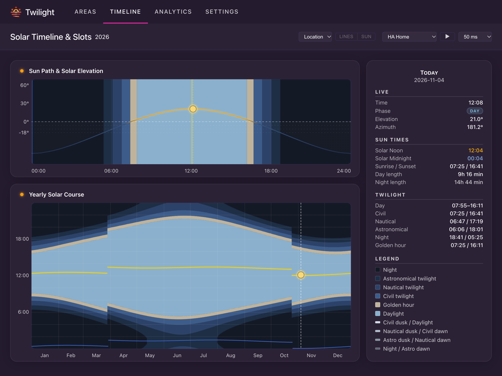
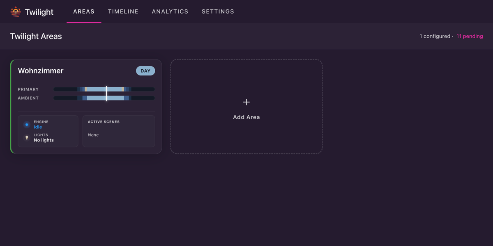
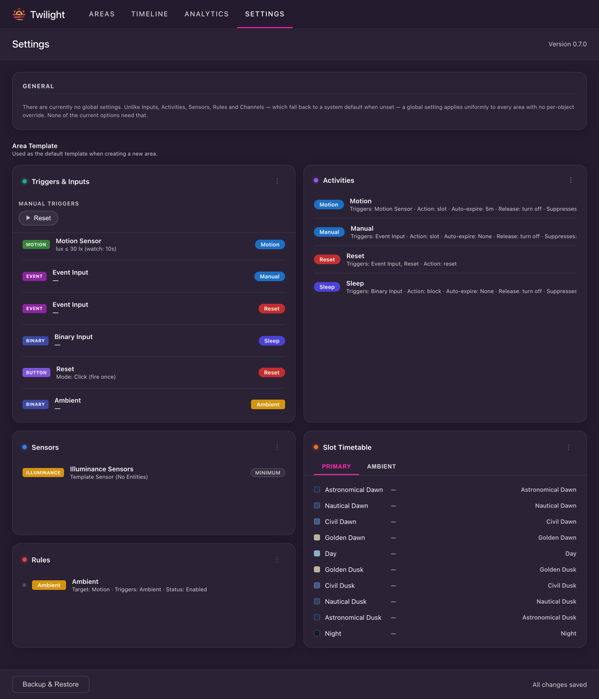

# [Twilight](https://github.com/bjrnptrsn/twilight) für Home Assistant

<p align="center">
  <a href="https://github.com/bjrnptrsn/twilight"></a>
</p>

<p align="center">
  <a href="#installation"></a>
  <a href="https://github.com/bjrnptrsn/twilight/releases"></a>
</p>

<p align="center">
  <a href="README.md">🇬🇧 English</a> · 🇩🇪 Deutsch
</p>

<p align="center">
  <strong>Intelligente, sonnenbewusste Lichtsteuerung für dein Zuhause.</strong><br>
  Lass die Sonne den Zeitplan bestimmen — nicht deine Uhr.
</p>

<p align="center">
  
</p>

<p align="center">
  🌅 <b>Folge der Sonne</b> mit 10 Zeit-Slots pro Area, von der Dämmerung bis zur Nacht.<br>
  🔄 <b>Teile einen Raum in Kanäle</b> — Lichtgruppen mit eigenen Zeitplänen.<br>
  🧠 <b>Reagiere auf dein Zuhause</b> mit Bewegung, Sensoren, Timern, Buttons und Schaltern.<br>
  🎯 <b>Nutze deine vorhandenen Scenes</b> — Home-Assistant-Scenes, Hue-Scenes, Scripts.<br>
  🌈 <b>Spiele dynamische Hue-Scenes</b> — auch in gemischten Räumen, Lichter ohne Rotation behalten ihre Farbe.<br>
  ⚡ <b>Ändere das Verhalten im laufenden Betrieb</b> mit Rules, etwa Licht an während eines Meetings.<br>
  🔍 <b>Sieh, was abweicht</b> — jedes Licht live verglichen mit den Vorgaben seiner Scene.<br>
  🏠 <b>Lass dein Zuhause bewohnt wirken</b> — mit einer Anwesenheitssimulation aus deinen Gewohnheiten.<br>
  📊 <b>Entdecke deine Gewohnheiten</b> in einer Wochentags-Heatmap.<br>
  🖥️ <b>Richte alles im Panel ein</b> — ganz ohne YAML.
</p>

> [!NOTE]
> **Beta / Aktive Entwicklung** — voll funktionsfähig, getestet und im täglichen
> Live-Einsatz erprobt. Das Konfigurationsmodell kann sich in weiteren Versionen noch anpassen.
> Feedback willkommen über [GitHub Issues](https://github.com/bjrnptrsn/twilight/issues).

---

## Warum es das gibt

Home Assistant kann Lichter ein- und ausschalten, aber Lichtszenen an den
Sonnenstand anzupassen — astronomische Dämmerung, bürgerliche Dämmerung,
goldene Stunde — erfordert immer noch komplexe Automationen, Templates und
manuelle Zeitpläne.

**Twilight ersetzt das alles** durch eine einzige Integration. Du definierst
Areas, jede mit sonnenausgerichteten Zeit-Slots und optionalen
Bewegungs-/Input-Overrides, und Twilight übernimmt die Übergänge. Keine
Template-Sensoren. Kein Scene-zu-Zeit-Abgleich. Keine Automations-Spaghetti.

Du willst das große Ganze sehen? [So funktioniert Twilight](SO_FUNKTIONIERT_ES.md)
zeigt, wie alles zusammenspielt, und die [Beispielkonfigurationen](BEISPIELE.md)
zeigen vollständige Setups für typische Situationen.

## Voraussetzungen

- Home Assistant 2026.3 oder neuer
- Der Standort deines Zuhauses in Home Assistant — daraus werden die Sonnenzeiten berechnet
- Optional: ein Bewegungsmelder und ein Helligkeitssensor für automatisches Licht
- Optional: die [Hue-Integration](https://www.home-assistant.io/integrations/hue/) für Hue-Scenes und der Recorder für die Aktivitäts-Heatmaps

Das Panel folgt automatisch der Sprache deines Home Assistant — verfügbar auf Deutsch, Dänisch, Englisch, Finnisch, Französisch, Italienisch, Niederländisch, Norwegisch, Polnisch, Portugiesisch, Schwedisch, Slowakisch, Spanisch, Tschechisch, Türkisch, Ukrainisch und vereinfachtem Chinesisch.

## Installation

Installiere Twilight über den **Marketplace** (ab Home Assistant 2026.11) oder **HACS** (ältere Versionen):

[](https://my.home-assistant.io/redirect/hacs_repository/?owner=bjrnptrsn&repository=twilight&category=integration)

### Über den Marketplace (ab Home Assistant 2026.11)

1. **Einstellungen → Marketplace** öffnen (erfordert ein verknüpftes GitHub-Konto) und nach **Twilight** suchen.
2. **Twilight** auswählen und auf **Installieren** klicken.
3. **Home Assistant neu starten.**
4. Unter **Einstellungen → Geräte & Dienste → Integration hinzufügen** nach **Twilight** suchen und hinzufügen.
5. Seitenleiste öffnen und auf **Twilight** klicken, um das Panel zu starten.

### Über HACS (ältere Home-Assistant-Versionen)

1. **HACS** öffnen, nach **Twilight** suchen und auf **Download** klicken.
2. **Home Assistant neu starten.**
3. Unter **Einstellungen → Geräte & Dienste → Integration hinzufügen** nach **Twilight** suchen und hinzufügen.
4. Seitenleiste öffnen und auf **Twilight** klicken, um das Panel zu starten.

<details>
<summary>Manuelle Installation (ohne Marketplace oder HACS)</summary>

1. Lade das [neueste Release](https://github.com/bjrnptrsn/twilight/releases) herunter.
2. Kopiere `custom_components/twilight` in deinen `custom_components`-Ordner.
3. **Home Assistant neu starten.**
4. Unter **Einstellungen → Geräte & Dienste → Integration hinzufügen** nach **Twilight** suchen und hinzufügen.
5. Seitenleiste öffnen und auf **Twilight** klicken, um das Panel zu starten.

</details>

> [!WARNING]
> Twilight muss als Integration hinzugefügt werden (**Einstellungen → Geräte &
> Dienste → Integration hinzufügen**), bevor das Sidebar-Panel erscheint. Die
> gesamte Konfiguration erfolgt danach im Panel — die Integration selbst hat
> keine eigenen Optionen.

## Schnellstart

| Schritt | Aktion |
| :--- | :--- |
| **1. Area anlegen** | Das **Twilight**-Panel öffnen, auf **Bereich hinzufügen** klicken und eine deiner Home-Assistant-Areas wählen. Sie wird sofort mit den Vorgaben aus dem [Area-Template](#settings--area-template) gespeichert: 10 astronomische Zeit-Slots, ausgerichtet auf deinen Standort, plus ein Standardsatz an Inputs und Activities. |
| **2. Scenes wählen** | In der Karte **Slot-Zeitplan** das **⋮**-Menü öffnen, **Slots bearbeiten** wählen und für jeden gewünschten Slot eine Scene oder ein Script auswählen. Die Lichter liest Twilight aus deinen Scenes — siehe [Welche Lichter Twilight steuert](#welche-lichter-twilight-steuert). |
| **3. Auslöser verbinden** | In **Auslöser & Eingänge** deinen Bewegungsmelder dem Motion-Input zuweisen. Die Standard-Inputs starten ohne Entities, ohne diesen Schritt reagiert also nichts. |
| **4. Lux-Sensor hinzufügen** *(optional)* | Unter **Sensoren** einen Helligkeitssensor hinzufügen, damit Bewegung das Licht nur einschaltet, wenn der Raum dunkel genug ist — siehe [Helligkeitsprüfung für Bewegung](#helligkeitsprüfung-für-bewegung). |
| **5. Fertig!** | Geh in den Raum. Der **Live-Monitor** zeigt, welche Activity läuft und was sie ausgelöst hat. |

---

## Inhaltsverzeichnis

- [Grundkonzept](#grundkonzept)
  - [Areas](#areas)
  - [Kanäle & Slots](#kanäle--slots)
  - [Scenes](#scenes)
    - [Dynamische Hue-Scenes](#dynamische-hue-scenes)
  - [Welche Lichter Twilight steuert](#welche-lichter-twilight-steuert)
  - [Wie Lichter geschaltet werden](#wie-lichter-geschaltet-werden)
- [Inputs & Activities](#inputs--activities)
  - [Sensoren](#sensoren)
  - [Inputs](#inputs)
    - [Helligkeitsprüfung für Bewegung](#helligkeitsprüfung-für-bewegung)
  - [Activities](#activities)
    - [Actions & Release Actions](#actions--release-actions)
  - [Manuelle Auslöser (Button-Inputs)](#manuelle-auslöser-button-inputs)
  - [Rules](#rules)
- [Frontend-Tabs](#frontend-tabs)
  - [Areas](#areas-tab)
    - [Die Area-Ansicht lesen](#die-area-ansicht-lesen)
  - [Timeline](#timeline-tab)
  - [Analytics](#analytics-tab)
  - [Settings & Area-Template](#settings--area-template)
    - [Backup, Restore & Factory Reset](#backup-restore--factory-reset)
- [Services](#services)
- [Diagnostics](#diagnostics)
- [Fehlerbehebung](#fehlerbehebung)
  - [Debug-Logging](#debug-logging)
- [Bekannte Einschränkungen](#bekannte-einschränkungen)
- [Mitwirken](#mitwirken)
- [Lizenz](#lizenz)

---

## Grundkonzept

Jede aktivierte **Area** durchläuft dieselbe Pipeline: Sensoren speisen
Inputs, Inputs fordern Activities an, und immer genau eine Activity steuert
zur gleichen Zeit die Lichter auf jedem Kanal.

```
Sensoren  →  Inputs  →  Activity-Auswahl (eine aktive Activity)  →  Action  →  Kanäle/Slots  →  Lichter
```

**Ohne Activity schaltet Twilight nichts ein.** Ein Zeit-Slot entscheidet nur,
*welche Scene laufen würde* — der Zeitplan allein schaltet nie etwas ein.
Etwas muss zuerst eine Activity anfordern (Bewegung, ein Button, ein Timer,
…). Das ist der häufigste Stolperstein beim Einrichten einer neuen Area: Wenn
nichts reagiert, prüfe, ob wirklich ein Input konfiguriert ist, der die
Motion- oder Manual-Activity auslöst — nicht ob dem Slot eine Scene zugewiesen
ist. Endet eine Activity, entscheidet ihre Freigabeaktion, ob die Lichter ausgehen
oder anbleiben.

### Areas

Jede **Area** entspricht einer Home-Assistant-Area. Du konfigurierst ihre
Lichtgruppen (Channels), Sensoren, Inputs und Activities unabhängig
voneinander, sodass unterschiedliche Räume völlig unterschiedliche Logik haben
können.

### Kanäle & Slots

Jede Area hat einen **Primary Channel** mit 10 fixen astronomischen Slots:

`Nacht → Astronomische Dämmerung → Nautische Dämmerung → Bürgerliche Dämmerung → Goldene Dämmerung → Tag → Goldene Abenddämmerung → Bürgerliche Abenddämmerung → Nautische Abenddämmerung → Astronomische Abenddämmerung`

Ihre Reihenfolge und astronomische Zone sind fest — bearbeiten kannst du die
zugewiesene Scene/das Script pro Slot, einen Offset in Minuten sowie (bei
Hue-Scenes, die es unterstützen) die dynamische Farbrotation.

Du kannst bis zu **3 Custom Channels** pro Area hinzufügen, jeder mit einer
frei definierbaren Liste von bis zu 10 Slots, um eine separate Lichtgruppe nach eigenem
Zeitplan zu steuern — bei gemeinsam genutzten Sensoren und Inputs (z. B.
Außenlicht, das nicht demselben Verlauf folgt wie deine Innenbeleuchtung).
Jeder Custom-Slot startet entweder zu einem **Sonnenereignis** (beliebige
astronomische Zone, mit Offset) oder zu einer **festen Uhrzeit** (`HH:MM`) und
hat eine eigene Scene-/Script-Zuweisung.

| Channel-Typ | Slots | Anwendungsfall |
|--------------|-------|----------|
| **Primary** | 10 fixe astronomische Zonen | Haupt-Innenbeleuchtung — folgt der Sonne |
| **Custom** (bis zu 3) | Frei definierbar — Sonnenereignis oder feste Zeit + Offset | Außenlicht, Akzentbeleuchtung, separate Zeitpläne |

Die Abend-Slots (goldene, bürgerliche, nautische und astronomische
Abenddämmerung sowie Nacht) können zusätzlich einen **Frühesten Start** zwischen
12:00 und 03:59 bekommen — Uhrzeiten von 00:00 bis 03:59 bedeuten nach Mitternacht
derselben Nacht. Im Winter, wenn es früh dunkel wird, wartet der Slot dann bis zu
dieser Uhrzeit, statt mit der Sonne zu starten; der Slot davor dauert länger, und
die folgenden Abend-Slots rücken um denselben Betrag mit. An Sommerabenden, wenn
das Sonnenereignis ohnehin später liegt, ändert sich nichts. Beispiel: Frühester
Start 22:00 auf der nautischen Abenddämmerung hält deine Scene der bürgerlichen
Abenddämmerung den ganzen Winter bis 22:00, astronomische Abenddämmerung und Nacht
folgen im gewohnten Abstand. Ein Abend-Slot startet nie nach dem nächsten
Morgen-Slot seines Channels: In kurzen Sommernächten startet er dann kurz vor der
Dämmerung.

Jeder Channel hat außerdem eine eigene **Slot-Überblenddauer**
(Standard 60 s) — die Überblendzeit beim Wechsel von einem Slot zum
nächsten.

### Scenes

Twilight unterstützt verschiedene Scene-Quellen, zugewiesen pro Slot:

- **Normale Scenes** — Standard-Home-Assistant-Scenes, erstellt über die HA-UI oder `configuration.yaml`
- **Hue-Scenes** — Hue-Scenes von deiner Hue Bridge (benötigt die [Hue-Integration](https://www.home-assistant.io/integrations/hue/)). Sie können auch als [dynamische Scenes](#dynamische-hue-scenes) laufen.
- **Scripts** — jedes Home-Assistant-Script, das Lichter steuern kann. Twilight sieht nicht, welche Lichter ein Script nutzt: Füge sie also [von Hand hinzu](#welche-lichter-twilight-steuert), wenn sie mit den anderen ausgehen sollen.

#### Dynamische Hue-Scenes

Eine Hue-Scene mit dynamischer Palette kann ihre Farben weiter rotieren lassen,
solange der Slot läuft. Die Spalte **Dynamisch** im Slot-Editor legt das pro
Slot fest:

| Einstellung | Wirkung |
|---|---|
| **Hue** | Folgt der Einstellung der Scene in der Hue-App, die in Klammern steht. Das ist der Standard. |
| **An** | Startet die Scene immer dynamisch. |
| **Aus** | Hält die Scene statisch. |

**Tempo** wählt die Geschwindigkeitsstufe der Hue-App, von 1 (sehr langsam)
bis 12 (extrem); **Hue** nutzt das aktuell in der Scene gespeicherte Tempo, das
in Klammern steht. Eine Stufe wird beim Start des Slots in die Hue-Scene
geschrieben: Die Hue-App zeigt sie ebenfalls an, sie bleibt erhalten, wenn du
zurück auf **Hue** stellst, und andere Slots, die diese Scene mit **Hue** nutzen,
laufen dann ebenfalls in dieser Stufe.

Die Spalte erscheint nur bei Scenes, deren Lichter wirklich eine dynamische
Palette abspielen können. In einem gemischten Raum behalten Lichter, die keine
Farben rotieren können, ihre feste Scene-Farbe, während die anderen die Palette
abspielen. Rotierende Lichter werden nicht als Abweichung gemeldet, weil sich
ihre Farbe absichtlich ändert.

### Welche Lichter Twilight steuert

Twilight liest die Lichter aus deinen Scenes, normalerweise musst du also nichts
einstellen. Die Karte **Leuchten & Geräte** listet sie auf, und ihr **⋮**-Menü
zeigt, was pro Channel und Slot gefunden wurde.

Scripts und Scenes, die Twilight nicht lesen kann, verraten keine Lichter. Dafür
legt der Button **Ausschalt-Entitäten** neben der Scene oder dem Script im
Slot-Editor fest, was mit ihnen ausgeht. Die Aktion **Szene / Skript** hat
denselben Button. Diese Liste schaltet nie etwas ein.

### Wie Lichter geschaltet werden

- **Beim Start einer Activity** entscheidet ihre Aktion. Bei **Slot** gehen die Lichter des aktuellen Slots sofort an, ohne Überblendung.
- **Beim Slot-Wechsel** blenden eingeschaltete Lichter über die **Slot-Überblenddauer** des Channels zur neuen Scene über. Ein ausgeschaltetes Licht bleibt aus — außer eine Scene oder ein Script läuft als Ganzes, etwa eine dynamische Hue-Scene, die die Hue Bridge vollständig einschaltet. Ein komplett ausgeschalteter Channel wird wieder eingeschaltet, außer du hast ihn von Hand ausgeschaltet und **Manuelles Aus respektieren** ist an.
- **Beim Ende einer Activity** läuft ihre Freigabeaktion. **Ausschalten** blendet über die **Ausschalt-Überblendung** der Activity aus, falls eine eingestellt ist; bereits ausgeschaltete Lichter bekommen ein einfaches Aus.
- **Befehle werden geprüft.** Twilight sendet einen Befehl erneut an Lichter, die ihr Ziel nicht erreicht haben, und schickt Befehle ohne Überblendung mehrfach, weil manche Lichter sie verpassen, ohne dass Home Assistant es merkt.
- **Änderungen von außen** — ein Wandschalter, eine App, ein Sprachassistent — werden nicht rückgängig gemacht. Ein gedimmtes Licht erscheint als Abweichung und folgt beim nächsten Slot-Wechsel oder Auslöser wieder Twilight; ein ausgeschaltetes Licht bleibt bis zum nächsten Auslöser aus. Schaltest du alle Lichter eines Channels aus, holt der nächste Slot mit Licht sie zurück, außer **Manuelles Aus respektieren** ist an. Details stehen in [So funktioniert Twilight](SO_FUNKTIONIERT_ES.md#wenn-jemand-ein-licht-direkt-schaltet).
- **Wenn du eine Scene änderst,** in der Hue-App oder in Home Assistant, übernimmt Twilight das von selbst. Lichter einer laufenden Scene folgen sofort; sind alle aus, bleiben sie aus.

---

## Inputs & Activities

### Sensoren

Sensoren sind passive Messwerte ohne garantiertes Event bei jeder Änderung —
sie unterstützen Inputs, statt selbst Activities auszulösen. Aktuell
unterstützt Twilight einen Sensor-Typ:

- **Beleuchtungsstärke (Lux)** — einer pro Area. Füge eine oder mehrere
  `sensor.*`-Entities hinzu; bei mehreren werden ihre Werte über eine
  **Aggregations**-Methode kombiniert: Minimum (Standard), Maximum,
  Durchschnitt oder Median. Der aggregierte Wert ist das, womit Motion-Inputs
  ihren Lux-Schwellwert vergleichen.

### Inputs

**Inputs** sind die Event-Quellen, die eine Activity anfordern. Jeder Input
hat einen Namen und lässt sich in den Einstellungen verwalten.

| Input-Typ | Löst aus bei | Hinweise |
|------------|-------------|-------|
| **Motion** | Eine seiner Entities (`binary_sensor`, `device_tracker`, `sensor`, `input_boolean`, `switch`) wechselt zu `on`/`home` | Keine Freigabe, wenn der Melder wieder ruhig wird — ein Bewegungsmelder fällt nach Sekunden ab, die Aktivität endet stattdessen über ihren Timer. Optionale [Helligkeitsprüfung](#helligkeitsprüfung-für-bewegung); Re-Trigger-Modus (Jeder Wechsel / Nur der erste Wechsel) |
| **Binary** | Eine/Alle/Anzahl seiner Entities (`input_boolean`, `binary_sensor`, `switch`, `sensor`) (konfigurierbare Aggregation) | Sendet beim Deaktivieren ein Release |
| **Event** | Statusänderung einer `event.*`-Entity, optional gefiltert auf einen Event-Typ | Feuert einmal pro passendem Event, kein Release |
| **Timer** | Eine tägliche feste Uhrzeit (`HH:MM:SS`) | Keine Entity nötig — nützlich für einen nächtlichen Reset |
| **Button** | Manuell über das Areas-Panel oder den Service `twilight.trigger_input` | Click-Modus feuert einmal; Toggle-Modus sendet beim zweiten Aufruf zusätzlich ein Release — siehe [Manuelle Auslöser](#manuelle-auslöser-button-inputs) |

Jeder Input zielt entweder auf eine **Activity** oder eine **Rule** (über
„Target Type”). Binary- und Toggle-Button-Inputs können frei wählen; Motion-,
Event-, Timer- und Click-Button-Inputs zielen immer auf eine Activity.

#### Helligkeitsprüfung für Bewegung

Mit einem Helligkeitssensor in der Area löst ein Motion-Input nur aus, wenn der
Raum dunkel genug ist. Das gilt für jede Bewegung, nicht nur für die erste:
Blockierte Bewegung verlängert auch keinen laufenden Timer. Ohne
Helligkeitssensor gibt es keine Prüfung.

| Einstellung | Wirkung |
|---|---|
| **Lux-Schwellenwert** | Bewegung löst bei diesem Wert oder darunter aus. Bleibt das Feld leer, gilt der Standard von 30 lx, sofern die Area keinen eigenen Wert hat. |
| **Lux-Beobachtung** | Nach einer Blockade prüft Twilight so viele Sekunden weiter und löst aus, sobald es dunkel genug ist. Standard sind 10 Sekunden. |
| **Lux bei aktiver Szene ignorieren** | Überspringt die Prüfung, solange eine Twilight-Scene an ist. |
| **Lux ignorieren während** | Überspringt die Prüfung in den Dämmerungs-Slots (Morgen-/Abenddämmerung, Nacht) oder in allen Slots. |

> [!TIP]
> Ein Sensor, der deine Lampen sieht, misst mehr, sobald sie an sind. Bewegung
> wird dann blockiert, und die Lichter gehen nach Ablauf des Timers aus, obwohl
> du im Raum bist. **Lux bei aktiver Szene ignorieren** verhindert das.

### Activities

Eine Activity besitzt die Lichter, solange sie aktiv ist — es läuft immer nur
**eine Activity gleichzeitig**; eine neue Anfrage verdrängt sofort, was zuvor
aktiv war.

| Option | Beschreibung |
|---|---|
| **Eingangsunterdrückung** | Inputs, die ignoriert werden, solange diese Activity aktiv ist (z. B. eine Schlaf-Activity, die den Bewegungsmelder-Input unterdrückt) |
| **Auto-Ablauf aktivieren** | Ob überhaupt ein Timer läuft. Nicht angehakt endet die Activity nur, wenn ein Binärkontakt ausgeht, ein Toggle-Button ausgeschaltet wird oder eine andere Activity übernimmt. |
| **Auto-Ablauf-Dauer** | Wie lange der Timer läuft, sofern aktiviert. Leer bedeutet den Standardwert von 3 Stunden. |
| **Ausschalt-Überblendung** | Wie lange das Ausschalten dieser Activity ausgeblendet wird, in Sekunden — leer schaltet die Lichter sofort ohne Überblendung aus. |
| **Manuelles Aus respektieren** | Wurde ein Licht manuell ausgeschaltet, während diese Activity aktiv ist, bleibt es beim nächsten Slot-Wechsel aus, statt wieder eingeschaltet zu werden — nur eine Scene oder ein Script, das als Ganzes läuft, etwa eine dynamische Hue-Scene, schaltet es mit ein. Wurden alle Lichter eines Channels von Hand ausgeschaltet, bleibt der Raum bei jedem Slot-Wechsel dunkel, egal was der Slot startet. Ein neuer Auslöser (Bewegung, ein Schalter, ein Button) schaltet sie wie gewohnt wieder ein. |

#### Actions & Release Actions

Die Aktion entscheidet, was beim Start einer Activity mit den Lichtern passiert:

| Aktion | Effekt |
|---|---|
| **Slot** | Spielt die Szene des aktuellen Channels/Slots ab; erlaubt das gezielte Auswählen aktiver Channels und Slots |
| **Szene / Skript** | Aktiviert direkt eine ausgewählte Szene oder ein Script, unabhängig vom Zeitplan |
| **Nur blockieren (keine Aktion)** | Tut nichts mit den Lichtern, nützlich zusammen mit der Eingangsunterdrückung |
| **Anwesenheitssimulation** | Simuliert Anwesenheit, indem das Lichtverhalten einer ausgewählten Activity basierend auf historischen oder gespeicherten Bewegungsdichten abgespielt wird |
| **Zurücksetzen (Aus + Leerlauf)** | Beendet die Activity sofort und schaltet alle Lichter des Bereichs und seiner aktivierten Channels sowie die **Ausschalt-Entitäten** der laufenden Activity aus. Mit **Nur Ausschalt-Entitäten** schaltet es stattdessen nur die von dir gelisteten aus. Kann zusätzlich einen festen Befehl (An, Aus, Umschalten oder Aktivieren) an von dir gewählte `input_boolean`-, `switch`- oder `script`-Entities senden |

Die Freigabeaktion entscheidet, was beim Ende passiert. Zurücksetzen hat keine, weil es
die Activity sofort beendet.

| Freigabeaktion | Effekt |
|---|---|
| **Ausschalten** | Schaltet alle Slot-Lichter dieser Activity und ihre **Ausschalt-Entitäten** aus |
| **Zu Aktivität wechseln** | Eine andere Activity übernimmt mit ihrer eigenen Aktion und ihrem Timer |
| **Keine Lichtaktion** | Lässt die Lichter, wie sie sind; sie folgen den Slots nicht mehr |

Neue Activities im Editor werden als praktischer Startpunkt mit **Slot**/
**Keine Lichtaktion** vorbefüllt — das ist aber kein Backend-Fallback: löschst du
die Aktion einer Activity explizit, tut sie nichts — es gibt keinen impliziten
Standardwert.

#### Channel- und Slot-Auswahl

Bei der Aktion **Slot** kannst du in der UI pro Channel und Slot auswählen, welche Abschnitte aktiv geschaltet werden. Ist ein Slot für einen Channel abgewählt, bleibt dieser Channel in dem entsprechenden Zeitraum aus.

#### Anwesenheitssimulation (Presence Simulation)

Activities mit Anwesenheitssimulation lassen ein leeres Zuhause bewohnt
wirken, indem sie realistische Lichtmuster nachbilden. Du wählst eine
vorhandene Activity aus (z. B. deine Standard-Bewegungs-Activity), deren
Lichtverhalten und Dauer übernommen werden, und Twilight löst sie anhand der
Bewegungsdichte-Wahrscheinlichkeit über den Tagesverlauf aus:

- **Datenquelle**: entweder ein rollierendes 30-Tage-Fenster der Live-Recorder-Historie
  auswerten oder eines von bis zu **5 gespeicherten Heatmap-Profilen** pro Area
  wählen (gespeichert über die Heatmap-Karte, dort wählst du einen
  Zeitraum von 1 Woche bis 6 Monaten und die Auflösung).
- **Lux-Modus**: legt fest, wann simuliertes Licht angehen darf —
  Nur Dämmerung (Standard), Lux-Schwellenwert oder Immer.
- **Vorlagen-Aktivität**: jede Activity, die Lichter steuert (Slot oder Szene / Skript) und an ihrem Ende nicht zu einer anderen wechselt.
- **Simulationsintensität**: steuert, wie oft simulierte Auslöser feuern, von sehr dezent bis
  sehr aktiv, relativ zur gemessenen Bewegungsdichte.

Die Auslöse-Wahrscheinlichkeit richtet sich danach, an wie vielen Tagen zu
einer bestimmten Zeit tatsächlich Aktivität stattfand — ein Raum, der jeden
Abend genutzt wird, wird also häufiger simuliert als einer, der nur einmal
genutzt wurde. Eine laufende Simulation wird nach einem Home-Assistant-Neustart
automatisch fortgesetzt.

#### Standard-Activities

Vier Activities sind bei jeder neuen Area vorkonfiguriert (aus dem
Standard-[Area-Template](#settings--area-template)):

- **Motion** — ausgelöst durch den Bewegungs-Input, läuft standardmäßig 5 Minuten (wird bei erneuter Bewegung automatisch verlängert)
- **Manual** — ausgelöst durch den manuellen Auslöser-Input, unterdrückt Bewegung solange sie aktiv ist, kein Timer
- **Sleep** — ausgelöst durch den Binär-Schlaf-Input, unterdrückt Bewegung solange sie aktiv ist, kein Timer (endet, wenn der Schalter ausgeht)
- **Reset** — ausgelöst durch den Reset-Button oder -Input, schaltet die Lichter aus und beendet, was gerade läuft

Bearbeite oder ersetze sie über das Area-Template, und füge eigene für alles
andere hinzu — einen Guest-Modus, weitere Motion-Inputs mit
unterschiedlichen Lux-Schwellwerten und so weiter.

#### Auto-Expire & Verlängerung (Prolongation)

Auto-Expire bestimmt, wie lange eine Activity nach dem Auslösen aktiv bleibt:

- **Expliziter Timer-Schalter**: Über **Auto-Ablauf aktivieren** wird der Timer gezielt ein- oder ausgeschaltet. Ist das Häkchen nicht gesetzt, läuft die Activity ohne Zeitbegrenzung, bis sie explizit freigegeben wird (z. B. wenn ein Binärkontakt ausgeht, ein Toggle-Button ausgeschaltet wird oder eine andere Activity übernimmt). Manuelle Overrides oder Schlaf-Activities nutzen typischerweise keinen Timer.
- **Automatische Verlängerung**: Läuft der Timer ab, prüft Twilight automatisch, ob noch einer der auslösenden Inputs aktiv ist (z. B. ein Bewegungsmelder, der weiterhin auf `on` steht, ein Binärkontakt oder ein aktiver Toggle-Button). Ist das der Fall, verlängert sich der Timer um die volle Dauer, statt die Activity zu beenden. Die eingestellte Dauer ist daher eine **Mindestlaufzeit** und keine harte Abschaltschwelle — solange der Raum genutzt wird, bleibt die Activity aktiv.
- **Tageslichtbewusste Verlängerung**: Bei Bewegungs-Inputs wertet die Verlängerung die Helligkeit mit demselben Lux-Schwellwert aus wie beim Einschalten. Hat ausreichend Tageslicht den Raum erhellt, wird der Timer nicht verlängert und das Licht geht natürlich aus.

### Manuelle Auslöser (Button-Inputs)

Button-Inputs benötigen keine HA-Entity — sie werden direkt über das
Areas-Panel ausgelöst, oder aus einer Automation über den Service
`twilight.trigger_input` (siehe [Services](#services)). Zwei Modi:

- **Click** — feuert einmal, Fire-and-Forget (z. B. ein „Reset"-Button im Dashboard)
- **Toggle** — verfolgt einen An/Aus-Zustand, live ans Frontend übermittelt

Optional lässt sich **HA-Entität erstellen** an einem Button-Input aktivieren, um
ihn zusätzlich als echte Home-Assistant-Entity bereitzustellen: Der
Click-Modus erzeugt eine `button.*`, der Toggle-Modus eine `switch.*`.
Nützlich, wenn du ihn von einer physischen Dashboard-Kachel, einem
Sprachassistenten oder einer anderen Automation aus auslösen willst, ohne den
Service-Call zu nutzen.

### Rules

**Rules** sind eine temporäre, parallele Override-Ebene: Solange ein
Auslöser-Input (ein Schalter oder Toggle-Button) aktiv ist, verändern aktive
Rules das Verhalten der aktuell laufenden Activity oder Konfiguration — sie
steuern aber nie von sich aus Lichter. Anders als Activities (immer nur eine
gleichzeitig aktiv) können beliebig viele Rules parallel aktiv sein.

Aktuell gibt es einen Rule-Typ:

| Rule-Typ | Überschreibt | Auslöser & Bedingung |
|---|---|---|
| **Activity Rule** | Channel-/Slot-Auswahl, Auto-Expire-Verhalten und Input-Unterdrückung einer Ziel-Activity | Ausgelöst durch Binary- oder Toggle-Button-Input; wirkt nur, wenn die Ziel-Activity aktiv ist |

Eine **Activity Rule** wirkt auf genau eine Activity. Solange sie aktiv ist,
überschreibt ihre Einstellung die der Ziel-Activity: **Was in der Rule angehakt ist, gilt.**
Sind mehrere Rules für dieselbe Activity aktiv, gilt „Exclude gewinnt” — ein Slot
ist für einen Kanal nur dann aktiv, wenn er in allen aktiven Rules angehakt ist.

Beim Konfigurieren einer Activity Rule im Editor werden Einstellungen wie das Auto-Expire-Verhalten, Channel-Slots oder die Input-Unterdrückung dynamisch nur dann eingeblendet, wenn die gewählte Ziel-Activity diese unterstützt.

Eine Activity Rule kann zusätzlich optional steuern, was mit dem
**Auto-Expire**-Countdown der Ziel-Activity passiert, solange die Rule aktiv
ist ("Auto-Ablauf-Verhalten"):

| Modus | Effekt |
|---|---|
| **Keine** (Standard) | Kein Eingriff — der Timer läuft unbeeinflusst weiter. |
| **Pausieren** | Friert den Timer bei der aktuellen Restzeit ein; läuft nach Rule-Ende mit genau dieser Restzeit weiter. |
| **Aussetzen** | Friert den Timer bei null ein; die Activity läuft sofort nach Rule-Ende ab (außer eine andere Bedingung, z. B. aktive Bewegung, hält sie weiterhin aktiv). |
| **Neu starten** | Friert den Timer bei der vollen konfigurierten Dauer ein; die Activity bekommt nach Rule-Ende einen frischen vollen Timer. |

Ist bei der Ziel-Activity Auto-Expire deaktiviert, gibt es keinen Timer zum
Einfrieren — alle vier Modi bleiben dann wirkungslos.

**Regel-gewährtes Auto-Expire**: Hat die Ziel-Activity keinen eigenen Timer
(Auto-Expire deaktiviert), kann eine Rule ihr stattdessen einen *leihen* —
**Auto-Ablauf aktivieren** und eine Dauer direkt an der Rule einstellen. Der
Timer startet, sobald die Rule aktiv wird, und läuft nach Rule-Ende eigenständig
weiter, sodass die Activity sauber endet statt unbegrenzt weiterzulaufen. Ein
erneutes Auslösen der Activity, während die Rule noch aktiv ist, setzt den
geliehenen Timer auf die volle Dauer zurück; ein erneutes Auslösen nach
Rule-Ende findet keine Dauer mehr vor und läuft unbegrenzt weiter, wie jede
andere Activity ohne Auto-Expire. Dieser Modus schließt sich mit dem
Auto-Expire-Verhalten oben gegenseitig aus — eine Rule nutzt immer nur eines
von beiden, je nachdem, ob die Ziel-Activity bereits einen eigenen Timer hat.

Wird die Ziel-Activity einer Rule nachträglich so bearbeitet, dass sie eine der
konfigurierten Optionen der Rule nicht mehr unterstützt (z. B. Auto-Expire-Verhalten
bei einer Activity, die nun einen eigenen Timer hat), wird die Rule automatisch
deaktiviert und in der Rules-Liste mit einer Warnung markiert, bis sie angepasst wird.

Eine Rule kann außerdem, solange sie aktiv ist, andere Inputs unterdrücken —
z. B. eine „Ambient"-Rule, die für ihre Dauer den Bewegungsmelder-Input
ignoriert. Solange eine passende Rule aktiv ist, ersetzen ihre unterdrückten Inputs
die Input-Unterdrückungen der Ziel-Activity. Unterdrückte Inputs reagieren bis zum
Ende der Rule nicht mehr auf Auslöser — dasselbe Deaktivierungs-Prinzip wie bei der
[Input-Unterdrückung einer Activity](#activities), nur an die Rule gebunden. Eine Rule
kann nicht den Input unterdrücken, der sie selbst auslöst.

Eine Rule kann außerdem, solange sie aktiv ist, die Einstellung **Manuelles Aus
respektieren** der Ziel-Activity überschreiben — erzwinge Respektieren (manuell ausgeschaltete
Lichter bleiben unangetastet) oder Ignorieren (sie werden wie gewohnt wieder
eingeschaltet), unabhängig davon, was an der Activity selbst eingestellt ist,
oder belasse es bei der Einstellung der Activity (Standard).

Rules werden über die **Rules**-Karte in der Detailansicht einer Area oder im
[Area-Template](#settings--area-template) konfiguriert.

---

## Frontend-Tabs

Twilight liefert ein vollständiges Sidebar-Panel — nach der Ersteinrichtung
ist kein YAML-Editing mehr nötig.

### Areas-Tab

Übersichtskarten (mit Sparkline-Tagesverlauf und Live-Statistiken pro Area)
plus eine Detailansicht pro Area für die gesamte oben beschriebene
Konfiguration: Channels, Sensoren, Inputs, Activities, eine Activity-Heatmap-Karte
(Visualisierung von Wochentagsmustern aus Live-Recorder-Daten oder bis zu **5 gespeicherten
Heatmap-Profilen**) sowie eine Live-Status-Karte, die die aktuell aktive Activity und ihren Auslöser zeigt.

<p align="center">
  
</p>

#### Die Area-Ansicht lesen

- **Live-Monitor** — der aktive Slot pro Channel mit Scene und Uhrzeiten sowie der Engine-Zustand: welche Activity läuft, welcher Input sie ausgelöst hat und wann sie endet.
- **Slot-Zeitplan** — alle Slots eines Channels in ihrer festen Reihenfolge, der aktive ist hervorgehoben.
- **Leuchten & Geräte** — Status, Helligkeit und Farbe jedes Lichts. Weicht ein Licht von den Vorgaben des Slots ab, erscheint der Zielwert als Badge unter dem Wert. **Dynamisch** markiert ein Licht, dessen Farben gerade rotieren, und **Manuell aus** ein Licht, das von Hand ausgeschaltet wurde; es zeigt keinen Zielwert, weil das Badge schon sagt, warum es aus ist. **Überblenden** markiert ein Licht, das gerade zum nächsten Slot überblendet; Zwischenwerte können bis zum Ende der Überblendung als Abweichung erscheinen.
- **Auslöser & Eingänge** — jeder Input und die Activity, die er anfordert. Ein Input, der gerade nicht auslösen kann, ist abgedunkelt und nennt den Grund, z. B. **Deaktiviert durch Aktivität: Manual**.

Entities und Scenes erscheinen mit ihrem Anzeigenamen; fährst du mit der Maus über den Namen, siehst du die Entity-ID. Ohne Anzeigenamen steht dort die Entity-ID.

### Timeline-Tab

- **Tagesansicht** — der Sonnenverlauf durch die heutigen astronomischen Zonen, mit Live-Zeitanzeige
- **Jahresansicht** — dieselben Zonen über das ganze Jahr geplottet, damit du siehst, wie sie sich mit den Jahreszeiten verschieben
- **Area-Auswahl** — eine ausgewählte Area zeigt direkt ihre konfigurierten Slots des primären Channels in beiden Diagrammen; **Linien** blendet die Slot-Grenzen ein, und **Sonne** schaltet die Flächen zum Vergleich auf den echten Sonnenverlauf um
- **Demo-Standorte** — zeigen den echten Sonnenverlauf an Beispielstandorten weltweit, unabhängig von einer konfigurierten Area

<p align="center">
  
</p>

### Analytics-Tab

Eine nach Wochentagen aggregierte Aktivitäts-Heatmap auf Basis echter
Home-Assistant-Recorder-Daten — wechsle zwischen Bewegungs- und Lichtaktivität,
wähle Zeitraum und Auflösung, und speichere bis zu 5 Schnappschüsse pro Area,
um Nutzungsmuster im Zeitverlauf zu vergleichen.

### Settings & Area-Template

Die **Area-Template**-Einstellung ist die Vorlage, mit der jede *neue* Area
vorbefüllt wird: ihre Standard-Inputs (Bewegung, manueller Auslöser,
Reset-Auslöser, Binär-Schlaf-Trigger, Reset-Button und ein Ambient-Regel-Auslöser),
Standard-Activities (**Motion**, **Manual**, **Sleep**, **Reset**), eine
Standard-[Ambient-Rule](#rules), einen Beispiel-Custom-Channel „Ambient" sowie
die Standard-Slots des Primary-Channels (Offsets und Szenen pro Zone). Einmal
in den **Settings** bearbeitet, startet jede danach angelegte Area vorverkabelt
statt leer — bestehende Areas bleiben unberührt. Ein granularer **Reset to
System Defaults**-Dialog erlaubt es, einzelne Inputs/Activities/Rules/Channels
wiederherzustellen, ohne das ganze Template zurückzusetzen.

<p align="center">
  
</p>

### Backup, Restore & Factory Reset

Der Button **Backup & Restore** in der Settings-Fußleiste lädt einen
vollständigen Snapshot des Stores herunter — globale Einstellungen,
Area-Template und die Konfiguration jeder Area (kein Laufzeitzustand) — als
einzelne JSON-Datei, und kann auch daraus wiederherstellen.

Ein Restore **ersetzt die aktuelle Konfiguration vollständig**: Areas, die
nicht in der Backup-Datei enthalten sind, werden gelöscht, und alle Areas
starten sofort mit der importierten Konfiguration neu — kein Neustart von Home
Assistant nötig. Vor
jedem destruktiven Restore erscheint ein Bestätigungsdialog. Bereits
eingeschaltete Lichter behalten ihren letzten Zustand bis zum nächsten
regulären Slot-/Activity-Wechsel — beim Restore selbst wird nichts
zwangsweise umgeschaltet.

Backups älterer Twilight-Versionen werden beim Restore aktualisiert. Ein Backup
einer neueren Version lässt sich nicht in eine ältere einspielen.

Innerhalb des Backup & Restore-Dialogs steht außerdem die Funktion **Factory Reset**
zur Verfügung. Damit lässt sich Twilight nach einer expliziten Sicherheitsabfrage
vollständig auf den ursprünglichen Werkszustand zurücksetzen (alle Areas löschen
und Einstellungen/Templates zurücksetzen).

---

## Services

### `twilight.trigger_input`

Löst einen Button-Input aus einer Automation oder einem Script aus oder
gibt ihn frei — ganz ohne echte HA-Entity dafür.

| Feld | Erforderlich | Beschreibung |
|-------|----------|--------------|
| `area_id` | Ja | Die Home-Assistant-Area, die den Input enthält |
| `input_id` | Ja | Die `id` oder der Name des Button-Inputs (sichtbar in der Inputs-Liste) |
| `active` | Nein | Für Buttons im `toggle`-Modus: `true`/`false`, um den Zustand explizit zu setzen |

```yaml
service: twilight.trigger_input
data:
  area_id: living_room
  input_id: reset_btn
```

## Diagnostics

Lade einen vollständigen Diagnose-Snapshot über **Einstellungen → Geräte &
Dienste → Twilight → ⋮ → Diagnosedaten herunterladen** in Home Assistant herunter.
Er enthält den aktuellen Store (alle Areas + globale Einstellungen) sowie pro
Area den Live-Run-State, die aufgelöste Scene-Map (welche Entity in welchem
Slot läuft) und den letzten bekannten Zustand jedes gesteuerten Lichts —
nützlich beim Melden eines Bugs.

> [!NOTE]
> Die Datei enthält deine echten Entity-IDs, Scene-Namen und Area-Namen —
> nichts Geheimes (keine Tokens oder Zugangsdaten), aber potenziell
> aufschlussreich über dein Zuhause. Vor dem Anhängen an ein öffentliches
> GitHub-Issue kurz durchsehen.

---

## Fehlerbehebung

| Problem | Lösung |
|---------|--------|
| Lichter gehen nie an | Keine Activity ist aktiv — prüfen, ob wirklich ein Input mit einer Activity verknüpft ist; dass ein Slot eine Scene zugewiesen hat, reicht nicht, siehe [Grundkonzept](#grundkonzept) |
| Scene zeigt keine Lichter | Prüfen, ob die Scene noch existiert und erreichbar ist; bei einer Hue-Scene auch prüfen, ob die Hue-Integration geladen ist |
| Bewegungsmelder reagieren nicht | Den Wert deines Helligkeitssensors in Home Assistant mit dem **Lux-Schwellenwert** des Motion-Inputs vergleichen — Tageslicht oder deine eigenen Lampen können ihn darüber halten, siehe [Helligkeitsprüfung für Bewegung](#helligkeitsprüfung-für-bewegung). Das [Debug-Logging](#debug-logging) zeigt jede Entscheidung |
| Lichter gehen aus, obwohl du im Raum bist | Neue Bewegung wurde von der Helligkeitsprüfung blockiert, oft weil deine eigenen Lampen den Messwert angehoben haben, und der Timer ist abgelaufen. **Lux bei aktiver Szene ignorieren** aktivieren |
| Eine Hue-Scene rotiert plötzlich ihre Farben | Ihre dynamische Wiedergabe ist in der Hue-App aktiviert. **Dynamisch** für diesen Slot auf **Aus** stellen, siehe [Dynamische Hue-Scenes](#dynamische-hue-scenes) |
| Ein Input ist abgedunkelt und reagiert nicht | Er nennt den Grund: von einer Activity oder Rule unterdrückt, oder **Keine Entität konfiguriert** |
| Lichter blinken beim Neustart | Das sollte nicht passieren — beim Start spielt Twilight keine Scene ab. Bitte [ein Issue öffnen](https://github.com/bjrnptrsn/twilight/issues) |

### Debug-Logging

Der [Diagnostics-Download](#diagnostics) ist bei Konfigurations- und Zustandsfragen
meist hilfreicher — Debug-Logging lohnt sich, wenn du die tatsächlichen
Entscheidungen Event für Event sehen willst (warum eine Activity nicht
ausgelöst hat, warum ein Retry gefeuert hat, etc.).

#### Option 1: Über die UI (für Probleme, die du nachstellen kannst)
1. Gehe zu **Einstellungen** > **Geräte & Dienste** > **Integrationen** > **Twilight**.
2. Klicke auf das **⋮-Menü** (oben rechts) und wähle **Debug-Protokollierung aktivieren**.
3. Reproduziere das Problem und deaktiviere dann die Protokollierung. Die Datei wird automatisch heruntergeladen.
   *(Hinweis: Bei startbedingten Problemen HA nach dem Aktivieren der Protokollierung neu starten.)*

#### Option 2: Über YAML (für sporadische Probleme)
Füge dies zu deiner `configuration.yaml` hinzu (erfordert Neustart):

```yaml
logger:
  default: info
  logs:
    custom_components.twilight: debug
```

Die Debug-Protokollierung bleibt dann dauerhaft aktiv, auch über Neustarts hinweg — tritt ein Problem auf, das du nicht gezielt auslösen kannst, enthält das Log die Details also bereits. Entferne den Eintrag wieder, wenn du fertig bist, da das Log deutlich wächst.

#### Log finden und teilen
Gehe zu **Einstellungen** > **System** > **Protokolle**. Die Seite zeigt standardmäßig eine verdichtete Liste der Fehler und Warnungen — Debug-Einträge erscheinen erst in der Rohansicht, die du über das **⋮-Menü** öffnest (englisch *Show raw logs*). Über die Download-Schaltfläche daneben speicherst du das Log als Datei.

Idealerweise teilst du die vollständige Log-Datei. Möchtest du keine unbeteiligten Daten teilen, kannst du sie auf nur die Einträge der Integration reduzieren:

```bash
grep 'twilight' home-assistant_*.log > twilight.log
```

## Bekannte Einschränkungen

- Nur ein Beleuchtungsstärke-Sensor pro Area (mehrere Entities können jedoch in ihn einfließen)
- Nachdem Lichter über ihren Timer ausgegangen sind, kann es bei neuer Bewegung ein paar Sekunden dauern, bis sie wieder angehen: Ein träger Helligkeitssensor meldet eventuell noch den hellen Wert. **Lux-Beobachtung** prüft für die eingestellte Zeit weiter (Standard: 10 Sekunden); ein trägerer Sensor verpasst dieses Fenster, dann entscheidet die nächste Bewegung

## Mitwirken

Einen Bug gefunden oder eine Idee? [Ein Issue öffnen](https://github.com/bjrnptrsn/twilight/issues) auf GitHub.

## Lizenz

MIT License
