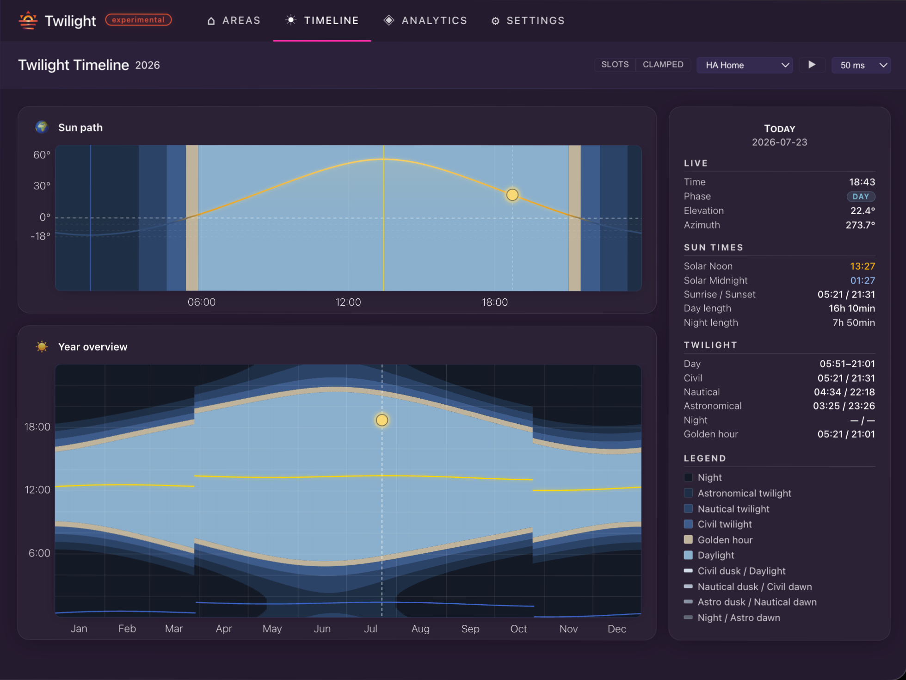
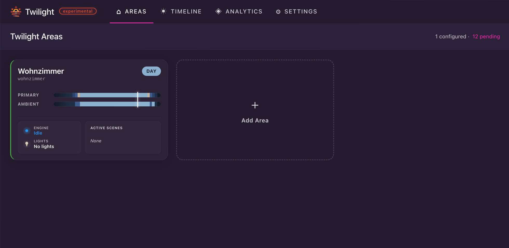
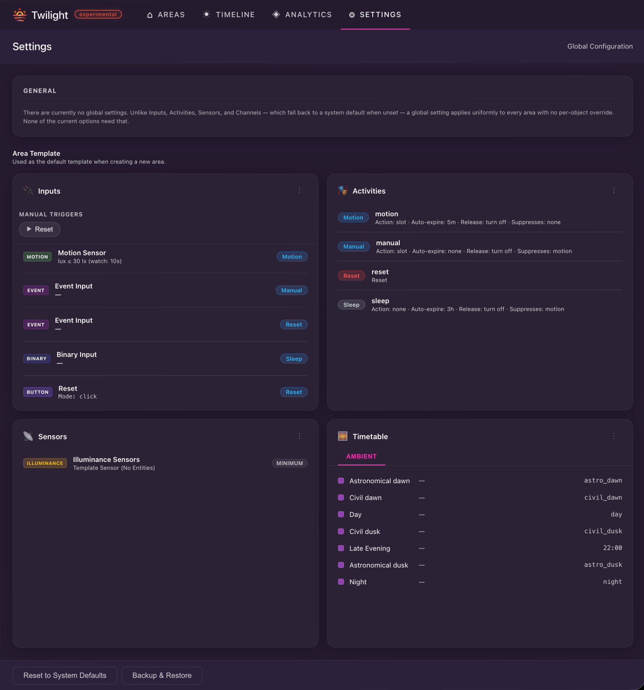

# Twilight for Home Assistant

<p align="center">
  
</p>

<p align="center">
  <strong>Intelligent, solar-aware lighting automation for your home.</strong><br>
  Let the sun set the schedule — not your watch.
</p>

<p align="center">
  
</p>

<p align="center">
  🌅 10 astral zones per area — dawn to dusk, golden hour to night.<br>
  🔄 Multiple channels per area — separate light groups, independent schedules.<br>
  🧠 Input-driven activities — motion, binary sensors, timers, buttons, events.<br>
  🎯 Scene-based execution — plain scenes, Hue scenes, scripts.<br>
  📊 Built-in analytics — uPlot charts with real Recorder data.<br>
  🕸️ Full Web UI — no YAML config needed after setup.
</p>

> [!CAUTION]
> **Experimental** — functional but not feature-complete, and not yet validated for long-term
> live use. The configuration model is still changing; expect breaking changes between
> versions with no migration path. Best suited for tinkerers and early adopters.
> Feedback welcome via [GitHub Issues](https://github.com/bjrnptrsn/twilight/issues).

---

## Table of Contents

- [Why this exists](#why-this-exists)
- [Prerequisites](#prerequisites)
- [Quick Start](#quick-start)
- [Installation](#installation)
- [Core Concept](#core-concept)
  - [Areas](#areas)
  - [Channels & Slots](#channels--slots)
  - [Scenes](#scenes)
- [Inputs & Activities](#inputs--activities)
  - [Sensors](#sensors)
  - [Inputs](#inputs)
  - [Activities](#activities)
    - [Actions & Release Actions](#actions--release-actions)
  - [Manual Triggers (Button Inputs)](#manual-triggers-button-inputs)
- [Frontend Tabs](#frontend-tabs)
  - [Areas](#areas-tab)
  - [Timeline](#timeline-tab)
  - [Analytics](#analytics-tab)
  - [Settings & Area Template](#settings--area-template)
    - [Backup, Restore & Factory Reset](#backup-restore--factory-reset)
- [Services](#services)
- [Diagnostics](#diagnostics)
- [Troubleshooting](#troubleshooting)
- [Known Limitations](#known-limitations)

---

## Why this exists

Home Assistant can turn lights on and off, but matching light scenes to the
sun's position — astronomical dawn, civil dusk, golden hour — still requires
complex automations, templates, and manual scheduling.

**Twilight replaces all of that** with a single integration. You define areas,
each with solar-aligned time slots and optional motion/input overrides, and
Twilight handles the transitions. No template sensors. No scene-to-time
matching. No spaghetti automations.

## Prerequisites

- Home Assistant 2025.5 or newer

## Quick Start

1. **Install** — copy the integration (see [Installation](#installation))
2. **Restart** Home Assistant
3. **Configure** — add `twilight:` to `configuration.yaml` and restart again
4. **Open** the Twilight panel in the sidebar
5. **Create an Area** — select an HA area, assign lights to channels
6. **Assign Scenes** — map your scenes to the astral time slots
7. **Add Inputs** — attach motion sensors, buttons, or timers to trigger activities

## Installation

### Manual Installation

1. Copy the `custom_components/twilight` directory to your HA `config/custom_components/` folder:

   ```bash
   cp -r custom_components/twilight /path/to/homeassistant/config/custom_components/
   ```

2. **Restart Home Assistant.**
3. Add the following to your `configuration.yaml`:

   ```yaml
   twilight:
   ```

4. **Restart Home Assistant** again.
5. Open the sidebar and click **Twilight** to launch the panel.

> [!WARNING]
> The `twilight:` line in `configuration.yaml` is required — it enables the
> integration. All configuration then happens in the sidebar panel.

### First Area Setup

1. Open the **Twilight** panel in the sidebar
2. Click **"Add Area"** and select one of your Home Assistant areas
3. Twilight creates 10 astral time slots automatically, aligned to your location's sun position, plus a default set of inputs/activities from the [area template](#settings--area-template)
4. In the **Channels** section, assign your light entities to the Primary channel
5. For each time slot, select a scene or script that should play during that period
6. Click **Save** — the engine starts immediately

---

## Core Concept

Every enabled **Area** runs the same pipeline: sensors feed inputs, inputs
request activities, and exactly one activity at a time controls the lights on
each channel.

```
Sensors  →  Inputs  →  Coordinator (one active_activity)  →  Action  →  Channels/Slots  →  Lights
```

**No activity active → lights are off.** A time slot only decides *which
scene would play* — the schedule alone never turns anything on. Something has
to request an activity first (motion, a button, a timer, …). This is the most
common point of confusion when setting up a new area: if nothing reacts, check
whether an input is actually configured to trigger the `motion`/`manual`
activity, not whether the slot has a scene assigned.

### Areas

Each **Area** maps to a Home Assistant area. You configure its light groups
(channels), sensors, inputs, and activities independently. An engine runs per
enabled area, so different rooms can have completely different logic.

### Channels & Slots

Every area has a **Primary channel** with 10 fixed astral slots:

`Night → Astronomical dawn → Nautical dawn → Civil dawn → Golden dawn → Day → Golden dusk → Civil dusk → Nautical dusk → Astronomical dusk`

Their order and solar zone are fixed — you can only edit each slot's assigned
scene/script and an offset in minutes.

You can add up to **3 custom channels** per area, each with a free-form slot
list, to control a separate light group on its own schedule while sharing the
same sensors and inputs (e.g. outdoor lights that don't follow the same curve
as your indoor lighting). Each custom slot starts either at a **sun event**
(any astral zone, with an offset) or a **fixed clock time** (`HH:MM`), and has
its own scene/script assignment.

| Channel Type | Slots | Use Case |
|--------------|-------|----------|
| **Primary** | 10 fixed astral zones | Main indoor lighting — follows the sun |
| **Custom** (up to 3) | Free-form — sun event or fixed time + offset | Outdoor lights, accent lighting, separate schedules |

### Scenes

Twilight supports different scene sources, assigned per slot:

- **Plain Scenes** — standard Home Assistant scenes created via the HA UI or `configuration.yaml`
- **Hue Scenes** — Hue Smart Scenes from your Hue Bridge (requires [Hue Integration](https://www.home-assistant.io/integrations/hue/))
- **Scripts** — any Home Assistant script that can control lights

---

## Inputs & Activities

### Sensors

Sensors are passive readings without a guaranteed event on every change — they
support inputs rather than triggering activities themselves. Today, Twilight
supports one sensor type:

- **Illuminance (Lux)** — one per area. Add one or more `sensor.*` entities;
  if you add more than one, their values are combined with an **aggregation**
  method: Minimum (default), Maximum, Average, or Median. The aggregated
  value is what motion inputs compare against their `lux_threshold`.

### Inputs

**Inputs** are the event sources that request an activity. Every input has a
stable `id`, used to reference it from an activity's `suppress_inputs`.

| Input Type | Triggers on | Notes |
|------------|-------------|-------|
| **Motion** | Any of its `binary_sensor.*`/`device_tracker.*` entities turning `on`/`home` | Optional `lux_threshold` gate; `retrigger` mode (`every` = every entity flip re-triggers, `first` = only the first entity to go active); optional `lux_watch_window` to retry after being blocked by light |
| **Binary** | Any/all/count of its `binary_sensor.*`/`input_boolean.*` entities (configurable `aggregation`) | Sends `activity_released` on the reverse transition |
| **Event** | A `event.*` entity's state change, optionally filtered to one `event_type` | Fires once per matching event, no release |
| **Timer** | A daily fixed clock time (`HH:MM:SS`) | No entity needed — useful for a nightly reset |
| **Button** | Manually via the Areas panel or the `twilight.trigger_input` service | `click` mode fires once; `toggle` mode also sends a release on the second call — see [Manual Triggers](#manual-triggers-button-inputs) |

Each input maps to exactly one **activity**. Multiple inputs of the same type
are allowed per area (e.g. two independent motion inputs with different lux
thresholds for different activities).

### Activities

An activity owns the lights while it is active — the coordinator only ever
lets **one activity run at a time**; a new request immediately displaces
whatever was active before.

| Option | Description |
|---|---|
| `suppress_inputs` | List of input `id`s to ignore while this activity is active (e.g. a `sleep` activity suppressing the `motion` input) |
| `auto_expire` | `HH:MM:SS` after which the activity ends automatically; `00:00:00`/empty = only ends on an explicit release |
| `expire_check_mode` | What happens right when the timer would expire: `disabled` (always ends), `respect_lux` (renews the timer if a motion input is still active *and* passes its lux check), `ignore_lux` (renews regardless of lux) |

#### Actions & Release Actions

What actually happens to the lights on start (`action`) and on end
(`release_action`):

| Action type | Effect | Applies to |
|---|---|---|
| `slot` (default) | Plays the current channel/slot's scene; supports `excluded_slot_ids` to force specific channels off during specific slots | action |
| `entity` | Activates one chosen scene or script directly, ignoring the schedule | action |
| `light` | Sets specific light entities directly — on/off, brightness, color temperature, or RGB — bypassing scenes entirely | action |
| `none` | Does nothing to the lights | action / release |
| `turn_off` | Turns off all of this activity's slot entities | release (default) |
| `reset` | Sends a fixed command (`on`/`off`/`toggle`/`activate`) to `input_boolean`, `switch`, or `script` entities you choose — for driving something other than lights, e.g. resetting a helper | action (no release phase) |
| `simulation` | Runs presence simulation | action |

If you don't configure an `action`, an activity defaults to playing the
current slot scene on start and turning all its lights off on release.

Four activities are preconfigured on every new area (from the default
[area template](#settings--area-template)):

- **`motion`** — triggered by a `motion` input, `auto_expire: 00:05:00`, `expire_check_mode: respect_lux`
- **`manual`** — triggered by a manual override input, suppresses `motion` while active, `auto_expire: 00:00:00` (release-only)
- **`sleep`** — triggered by a `binary` input, suppresses `motion` while active, `auto_expire: 03:00:00` (overnight safety net)
- **`reset`** — triggered by a button input, runs a `reset` action (no light control)

Edit or replace them via the area template, and add your own for anything
else — a `guest` mode, extra motion inputs with different lux thresholds, and
so on.

### Manual Triggers (Button Inputs)

Button inputs need no HA entity — they're triggered directly from the Areas
panel, or from an automation via the `twilight.trigger_input` service (see
[Services](#services)). Two modes:

- **Click** — fires once, fire-and-forget (e.g. a dashboard "Reset" button)
- **Toggle** — tracks on/off state, sent to the frontend live

Optionally, enable **Create Entity** on a button input to also expose it as a
real Home Assistant entity: `click` mode creates a `button.*`, `toggle` mode
creates a `switch.*`. Useful if you want to trigger it from a physical
dashboard tile, voice assistant, or another automation without going through
the service call.

---

## Frontend Tabs

Twilight ships with a full Lit-based sidebar panel — no YAML editing needed
after initial setup.

### Areas Tab

Overview cards (with a sparkline day chart and live stats per area) plus a
detail view per area for all configuration described above: channels, sensors,
inputs, activities, and a live status card showing the currently active
activity and what triggered it. New areas stay a local, unsaved draft until
you click **Save**.

<p align="center">
  
</p>

### Timeline Tab

- **Day view** — the sun's path through today's astral zones, with live time indicator
- **Year view** — the same zones plotted across the whole year, so you can see how slot durations shift with the seasons
- Includes a demo mode with example locations, independent of any configured area

<p align="center">
  
</p>

### Analytics Tab

uPlot charts backed by real Home Assistant Recorder data — dual Y-axes, a
time range selector, and per-area motion shown as background bands so you can
correlate light changes with actual sensor activity.

### Settings & Area Template

Two kinds of settings:

- **Global settings** — none currently. Almost every option lives on the
  object it affects (channel/input/activity/sensor) and falls back through
  its parent to a `const.py` default, so there is nothing that would only
  make sense as a single value shared by every area. The Settings tab keeps
  the category as a placeholder and explains this inline.
- **Area template** — the blueprint used to seed every *new* area: its
  default inputs (motion, manual override, reset, a binary sleep trigger, a
  manual-trigger button), default activities (`motion`, `manual`, `sleep`,
  `reset`), and default custom channels. Edit it once in
  **Settings** and every area you create afterwards starts pre-wired instead
  of empty — existing areas are unaffected. A granular **Reset to System
  Defaults** dialog lets you restore individual inputs/activities/channels
  without resetting the whole template.

<p align="center">
  
</p>

### Backup, Restore & Factory Reset

The **Backup & Restore** button in the Settings footer downloads a full
snapshot of the store — global settings, area template, and every area's
configuration (no runtime state) — as a single JSON file, and can restore
from one.

Restoring **completely replaces** the current configuration: areas not
present in the backup file are deleted, and all running engines are torn
down and rebuilt from the imported config immediately — no Home Assistant
restart required. A confirmation dialog is shown before any destructive
restore. Lights already on keep their last state until the next regular
slot/activity change; nothing is force-switched during the restore itself.

Inside the Backup & Restore dialog, a **Factory Reset** action is also
available to reset Twilight back to its initial system defaults — deleting
all custom areas and resetting global settings and templates after explicit
confirmation.

---

## Services

### `twilight.trigger_input`

Fires or releases a `button`-type input from an automation or script, without
needing a real HA entity for it.

| Field | Required | Description |
|-------|----------|--------------|
| `area_id` | Yes | The Home Assistant area containing the input |
| `input_id` | Yes | The button input's `id` (visible in the inputs list) |
| `active` | No | For `toggle`-mode buttons: `true`/`false` to set the state explicitly |

```yaml
service: twilight.trigger_input
data:
  area_id: living_room
  input_id: reset_btn
```

## Diagnostics

Download a full diagnostics snapshot via **Settings → Devices & Services →
Twilight → ⋮ → Download diagnostics** in Home Assistant. It contains the
current store (all areas + global settings) and, per area, the live run
state, the resolved scene map (which entity plays in which slot), and the
last known state of every controlled light — useful when reporting a bug.

---

## Troubleshooting

| Problem | Solution |
|---------|--------|
| Panel shows "Engine not running" | Ensure `twilight:` is in `configuration.yaml` and HA was restarted |
| Lights never turn on | No activity is active — check that an input is actually wired to an activity; a slot having a scene assigned is not enough, see [Core Concept](#core-concept) |
| Scene shows no lights | Check if the scene still exists and is reachable; if it involves a Hue Smart Scene, ensure the Hue Integration is loaded |
| Motion sensors not responding | Verify the lux threshold in the motion input — it may be suppressed by high ambient light; check the aggregated lux value on the area's status card |
| Lights flash on restart | This shouldn't happen — Twilight uses boot-catch-up to avoid unwanted activation. Please [open an issue](https://github.com/bjrnptrsn/twilight/issues) |
| Area not appearing in panel | Ensure the HA area exists and has at least one light entity assigned |

## Known Limitations

- Only one illuminance sensor per area (multiple entities can feed into it)
- No multi-language support yet (English only)
