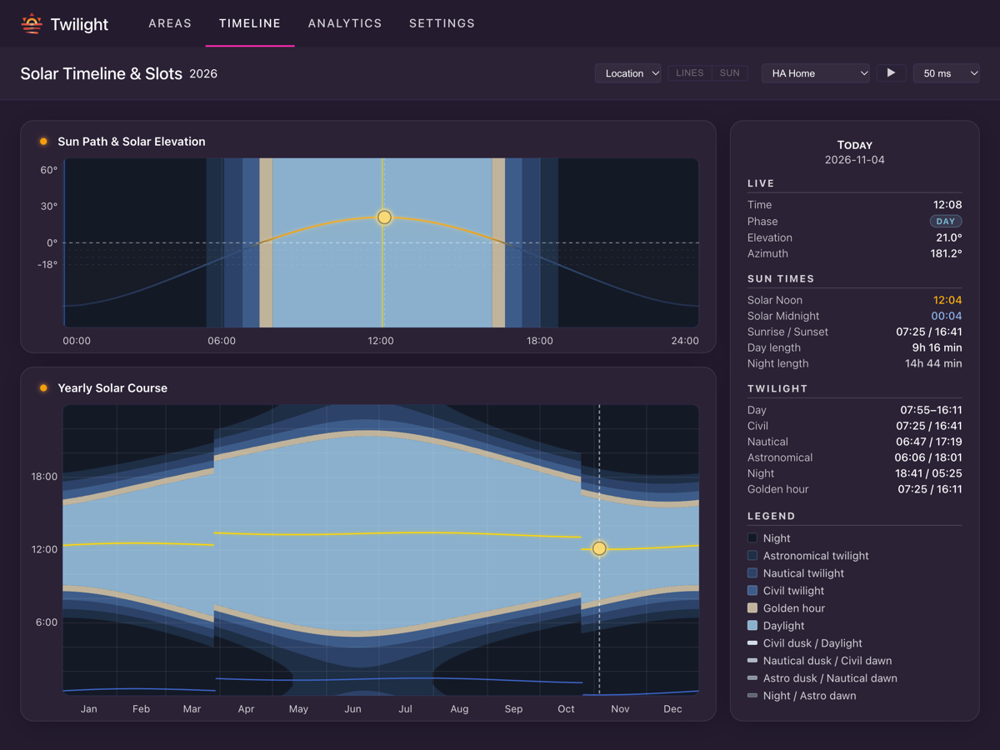
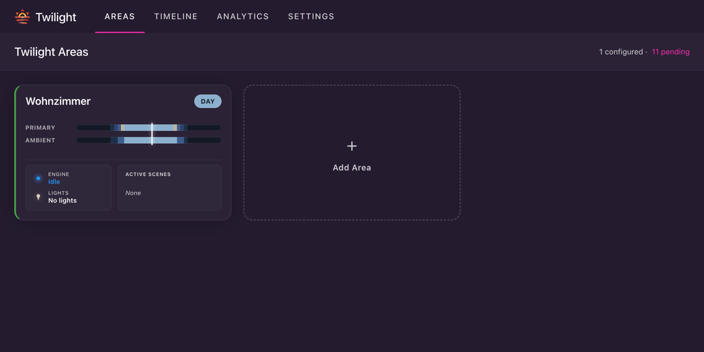
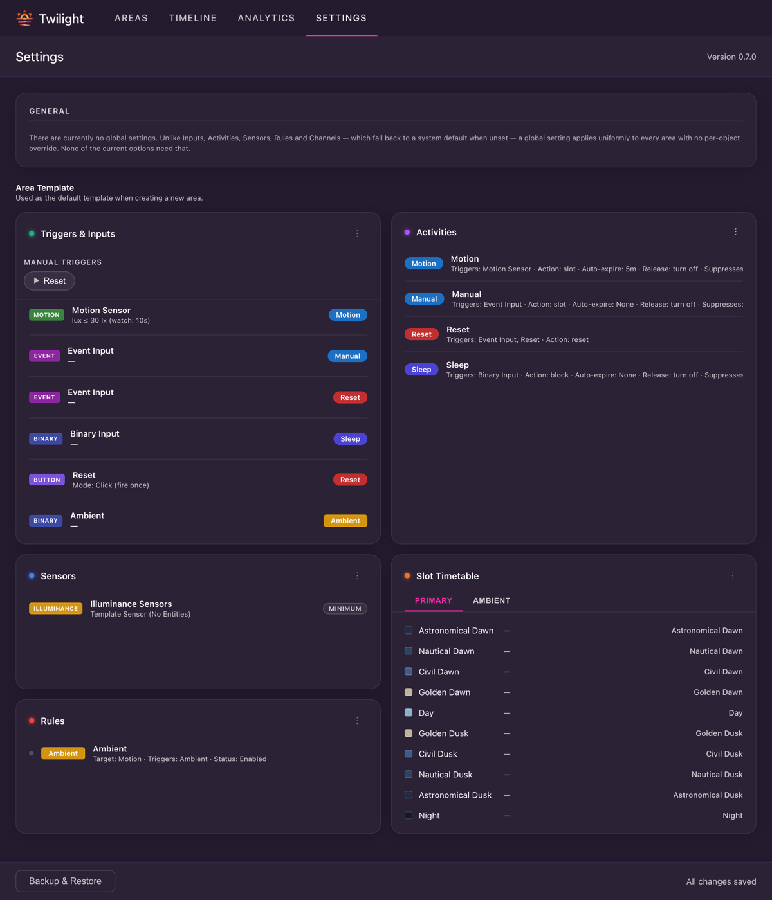

# [Twilight](https://github.com/bjrnptrsn/twilight) for Home Assistant

<p align="center">
  <a href="https://github.com/bjrnptrsn/twilight"></a>
</p>

<p align="center">
  <a href="#installation"></a>
  <a href="https://github.com/bjrnptrsn/twilight/releases"></a>
</p>

<p align="center">
  🇬🇧 English · <a href="LIESMICH.md">🇩🇪 Deutsch</a>
</p>

<p align="center">
  <strong>Intelligent, solar-aware lighting automation for your home.</strong><br>
  Let the sun set the schedule — not your watch.
</p>

<p align="center">
  
</p>

<p align="center">
  🌅 <b>Follow the sun</b> with 10 time slots per area, from dawn to night.<br>
  🔄 <b>Split a room into channels</b> — light groups with schedules of their own.<br>
  🧠 <b>React to your home</b> with motion, sensors, timers, buttons and switches.<br>
  🎯 <b>Use the scenes you already have</b> — Home Assistant scenes, Hue scenes, scripts.<br>
  🌈 <b>Play dynamic Hue scenes</b> — mixed rooms included, lights that can't rotate keep their color.<br>
  ⚡ <b>Change the behavior on the fly</b> with Rules, like keeping the light on during a meeting.<br>
  🔍 <b>See what differs</b> — every light compared live with what its scene asks for.<br>
  🏠 <b>Look occupied while you're away</b> with a presence simulation based on your own habits.<br>
  📊 <b>Explore your habits</b> in a weekday activity heatmap.<br>
  🖥️ <b>Set everything up in the panel</b> — no YAML needed.
</p>

> [!NOTE]
> **Beta / Active Development** — functional, tested, and proven in daily live use.
> The configuration model may still evolve; expect occasional breaking changes between
> versions. Feedback welcome via [GitHub Issues](https://github.com/bjrnptrsn/twilight/issues).

---

## Why this exists

Home Assistant can turn lights on and off, but matching light scenes to the
sun's position — astronomical dawn, civil dusk, golden hour — still requires
complex automations, templates, and manual scheduling.

**Twilight replaces all of that** with a single integration. You define areas,
each with solar-aligned time slots and optional motion/input overrides, and
Twilight handles the transitions. No template sensors. No scene-to-time
matching. No spaghetti automations.

Want the bigger picture? [How Twilight Works](HOW_IT_WORKS.md) shows how the
parts fit together, and the [Example Configurations](EXAMPLES.md) show complete
setups for common situations.

## Prerequisites

- Home Assistant 2026.3 or newer
- Your home's location set in Home Assistant — the sun times are calculated from it
- Optional: a motion sensor and an illuminance sensor for automatic lights
- Optional: the [Hue integration](https://www.home-assistant.io/integrations/hue/) for Hue scenes, and the Recorder for the activity heatmaps

The panel follows your Home Assistant language automatically — it's available in Czech, Danish, Dutch, English, Finnish, French, German, Italian, Norwegian, Polish, Portuguese, Simplified Chinese, Slovak, Spanish, Swedish, Turkish, and Ukrainian.

## Installation

Install Twilight via the **Marketplace** (Home Assistant 2026.11 or newer) or **HACS** (older versions):

[](https://my.home-assistant.io/redirect/hacs_repository/?owner=bjrnptrsn&repository=twilight&category=integration)

### Via the Marketplace (Home Assistant 2026.11 or newer)

1. Open **Settings → Marketplace** (requires a connected GitHub account) and search for **Twilight**.
2. Select **Twilight** and click **Install**.
3. **Restart Home Assistant.**
4. Go to **Settings → Devices & Services → Add Integration**, search for **Twilight**, and add it.
5. Open the sidebar and click **Twilight** to launch the panel.

### Via HACS (older Home Assistant versions)

1. Open **HACS**, search for **Twilight**, and click **Download**.
2. **Restart Home Assistant.**
3. Go to **Settings → Devices & Services → Add Integration**, search for **Twilight**, and add it.
4. Open the sidebar and click **Twilight** to launch the panel.

<details>
<summary>Manual installation (without Marketplace or HACS)</summary>

1. Download the [latest release](https://github.com/bjrnptrsn/twilight/releases).
2. Copy `custom_components/twilight` to your `custom_components` folder.
3. **Restart Home Assistant.**
4. Go to **Settings → Devices & Services → Add Integration**, search for **Twilight**, and add it.
5. Open the sidebar and click **Twilight** to launch the panel.

</details>

> [!WARNING]
> Twilight must be added as an integration (**Settings → Devices & Services →
> Add Integration**) before the sidebar panel appears. All configuration then
> happens in the panel — the integration itself has no options to set.

## Quick Start

| Step | Action |
| :--- | :--- |
| **1. Add an area** | Open the **Twilight** panel, click **Add Area** and pick one of your Home Assistant areas. It is saved right away with the [area template](#settings--area-template) defaults: 10 astral time slots aligned to your location, plus a default set of inputs and activities. |
| **2. Choose scenes** | In the **Slot Timetable** card, open the **⋮** menu, choose **Edit Slots** and pick a scene or script for each slot you want to use. Twilight reads the lights from your scenes — see [Which Lights Twilight Controls](#which-lights-twilight-controls). |
| **3. Connect a trigger** | In **Triggers & Inputs**, assign your motion sensor to the motion input. The default inputs start without entities, so nothing reacts until you do this. |
| **4. Add a lux sensor** *(optional)* | In **Sensors**, add an illuminance sensor so that motion only turns the lights on when the room is dark enough — see [Brightness Check for Motion](#brightness-check-for-motion). |
| **5. Done!** | Walk into the room. The **Live Monitor** shows which activity is running and what triggered it. |

---

## Table of Contents

- [Core Concept](#core-concept)
  - [Areas](#areas)
  - [Channels & Slots](#channels--slots)
  - [Scenes](#scenes)
    - [Dynamic Hue Scenes](#dynamic-hue-scenes)
  - [Which Lights Twilight Controls](#which-lights-twilight-controls)
  - [How Lights Are Switched](#how-lights-are-switched)
- [Inputs & Activities](#inputs--activities)
  - [Sensors](#sensors)
  - [Inputs](#inputs)
    - [Brightness Check for Motion](#brightness-check-for-motion)
  - [Activities](#activities)
    - [Actions & Release Actions](#actions--release-actions)
  - [Manual Triggers (Button Inputs)](#manual-triggers-button-inputs)
  - [Rules](#rules)
- [Frontend Tabs](#frontend-tabs)
  - [Areas](#areas-tab)
    - [Reading the Area View](#reading-the-area-view)
  - [Timeline](#timeline-tab)
  - [Analytics](#analytics-tab)
  - [Settings & Area Template](#settings--area-template)
    - [Backup, Restore & Factory Reset](#backup-restore--factory-reset)
- [Services](#services)
- [Diagnostics](#diagnostics)
- [Troubleshooting](#troubleshooting)
  - [Debug Logging](#debug-logging)
- [Known Limitations](#known-limitations)
- [Contributing](#contributing)
- [License](#license)

---

## Core Concept

Every enabled **Area** runs the same pipeline: sensors feed inputs, inputs
request activities, and exactly one activity at a time controls the lights on
each channel.

```
Sensors  →  Inputs  →  Activity Selection (one active activity)  →  Action  →  Channels/Slots  →  Lights
```

**Without an activity, Twilight switches nothing on.** A time slot only decides *which
scene would play* — the schedule alone never turns anything on. Something has
to request an activity first (motion, a button, a timer, …). This is the most
common point of confusion when setting up a new area: if nothing reacts, check
whether an input is actually configured to trigger the Motion or Manual
activity, not whether the slot has a scene assigned. When an activity ends, its
release action decides whether the lights go off or stay on.

### Areas

Each **Area** maps to a Home Assistant area. You configure its light groups
(channels), sensors, inputs, and activities independently, so different rooms
can have completely different logic.

### Channels & Slots

Every area has a **Primary channel** with 10 fixed astral slots:

`Night → Astronomical dawn → Nautical dawn → Civil dawn → Golden dawn → Day → Golden dusk → Civil dusk → Nautical dusk → Astronomical dusk`

Their order and solar zone are fixed — you can edit each slot's assigned
scene/script, an offset in minutes, and (for Hue scenes that support it)
dynamic color rotation.

You can add up to **3 custom channels** per area, each with a free-form list of
up to 10 slots, to control a separate light group on its own schedule while sharing the
same sensors and inputs (e.g. outdoor lights that don't follow the same curve
as your indoor lighting). Each custom slot starts either at a **sun event**
(any astral zone, with an offset) or a **fixed clock time** (`HH:MM`), and has
its own scene/script assignment.

Each light should belong to one channel only: if several channels control the
same light, their commands compete, and **Lights & Devices** lists that light
with its channels.

| Channel Type | Slots | Use Case |
|--------------|-------|----------|
| **Primary** | 10 fixed astral zones | Main indoor lighting — follows the sun |
| **Custom** (up to 3) | Free-form — sun event or fixed time + offset | Outdoor lights, accent lighting, separate schedules |

The evening slots (golden, civil, nautical and astronomical dusk, and night) can
also have an **Earliest start** between 12:00 and 03:59 — times from 00:00 to 03:59
mean after midnight of the same night. In winter, when it gets dark early, the slot
then waits until that time instead of starting with the sun; the slot before it
lasts longer, and the following evening slots move along by the same amount. On
summer evenings, when the sun event is already later, nothing changes. Example:
earliest start 22:00 on nautical dusk keeps your civil-dusk scene until 22:00 all
winter, with astronomical dusk and night following at their usual spacing. An
evening slot never starts after the channel's next morning slot: on short summer
nights it then starts just before dawn.

Each channel also has its own **slot transition duration** (default 60s) —
the crossfade time when moving from one slot to the next.

### Scenes

Twilight supports different scene sources, assigned per slot:

- **Plain Scenes** — standard Home Assistant scenes created via the HA UI or `configuration.yaml`
- **Hue Scenes** — Hue scenes from your Hue Bridge (requires [Hue Integration](https://www.home-assistant.io/integrations/hue/)). They can also play as [dynamic scenes](#dynamic-hue-scenes).
- **Scripts** — any Home Assistant script that can control lights. Twilight cannot see which lights a script uses, so [add them by hand](#which-lights-twilight-controls) if they should turn off with the rest.

#### Dynamic Hue Scenes

A Hue scene with a dynamic palette can keep rotating its colors while the slot
runs. The **Dynamic** column in the slot editor sets this per slot:

| Setting | Effect |
|---|---|
| **Hue** | Follows the scene's own setting in the Hue app, shown in brackets. This is the default. |
| **On** | Always starts the scene dynamically. |
| **Off** | Keeps the scene static. |

**Speed** selects the Hue app's speed level, from 1 (very slow) to 12
(extreme); **Hue** uses the speed currently stored in the scene, shown in
brackets. A level is written into the Hue scene when the slot starts: the Hue
app shows it too, it stays when you switch back to **Hue**, and other slots
using this scene on **Hue** run at it as well.

The column is only offered for scenes whose lights can actually play a dynamic
palette. In a mixed room, lights that cannot rotate colors keep their fixed
scene color while the others play the palette. Rotating lights are not reported
as deviating, since their color changes on purpose; the others are checked and
corrected like in a static scene.

### Which Lights Twilight Controls

Twilight reads the lights out of your scenes, so there is normally nothing to
configure. The **Lights & Devices** card lists them, and its **⋮** menu shows
what was found per channel and slot.

Scripts, and scenes Twilight cannot read, reveal no lights. For those, the
**Turn-Off Entities** button next to the scene or script in the slot editor sets
what goes off with them. A **Scene / Script** action has the same button. This
list never turns anything on.

### How Lights Are Switched

- **When an activity starts,** its action decides. With **Slot**, the lights of the current slot come on right away, without a fade.
- **When the slot changes,** lights that are on fade to the new scene over the channel's **Slot Transition Duration**. A light that is off stays off — except where a scene or script runs as a whole, such as a dynamic Hue scene, which the Hue Bridge switches on entirely. A channel that is off entirely is switched back on, unless you switched it off by hand and **Respect Manual Off** is on.
- **When an activity ends,** its release action runs. **Turn Off** fades out over the activity's **Transition Off**, if it has one; lights that are already off just get a plain off.
- **Commands are checked.** Twilight re-sends a command to lights that did not reach their target, and sends commands without a fade several times, because some lights miss them without Home Assistant noticing.
- **Changes from outside** — a wall switch, an app, a voice assistant — are not undone. A light you dimmed shows up as a deviation and follows Twilight again at the next slot change or trigger; a light you switched off stays off until the next trigger. If you switch off all lights of a channel, the next slot with light brings them back unless **Respect Manual Off** is on. [How Twilight Works](HOW_IT_WORKS.md#when-someone-switches-a-light-directly) has the details.
- **When you edit a scene** in the Hue app or in Home Assistant, Twilight picks up the change on its own. Lights of a scene that is playing follow right away; lights that are all off stay off.
- **When you save in the panel,** a change to what is running takes effect right away — a new scene for the current slot, another action, a changed timer or rule. The lights it affects go back to their target, a light you dimmed by hand included; a save that changes nothing that is running leaves the lights alone.

---

## Inputs & Activities

### Sensors

Sensors are passive readings without a guaranteed event on every change — they
support inputs rather than triggering activities themselves. Today, Twilight
supports one sensor type:

- **Illuminance (Lux)** — one per area. Add one or more `sensor.*` entities;
  if you add more than one, their values are combined with an **aggregation**
  method: Minimum (default), Maximum, Average, or Median. The aggregated
  value is what motion inputs compare against their illuminance threshold.

### Inputs

**Inputs** are the event sources that request an activity. Every input has a name
and can be configured in the UI.

| Input Type | Triggers on | Notes |
|------------|-------------|-------|
| **Motion** | Any of its entities (`binary_sensor`, `device_tracker`, `sensor`, `input_boolean`, `switch`) turning `on`/`home` | No release when the sensor goes quiet — a motion sensor drops within seconds, so the activity ends on its timer instead. Optional [brightness check](#brightness-check-for-motion); re-trigger mode (every flip / first flip) |
| **Binary** | Any/all/count of its entities (`input_boolean`, `binary_sensor`, `switch`, `sensor`) (configurable aggregation) | Sends a release when turned off |
| **Event** | A `event.*` entity's state change, optionally filtered to an event type | Fires once per matching event, no release |
| **Timer** | A daily fixed clock time (`HH:MM:SS`) | No entity needed — useful for a nightly reset |
| **Button** | Manually via the Areas panel or the `twilight.trigger_input` service | Click mode fires once; Toggle mode sends a release on the second call — see [Manual Triggers](#manual-triggers-button-inputs) |

Each input targets either an **Activity** or a **Rule** (via "Target Type").
Binary and toggle-mode button inputs can target either; motion, event, timer,
and click-mode button inputs always target an Activity.

#### Brightness Check for Motion

With an illuminance sensor in the area, a motion input only fires when the room
is dark enough. This applies to every motion, not just the first: blocked motion
does not extend a running timer either. Without an illuminance sensor, there is
no check.

| Setting | Effect |
|---|---|
| **Lux Threshold** | Motion fires at or below this value. Left empty, the default of 30 lx applies unless the area sets its own. |
| **Lux Watch** | After being blocked, Twilight keeps checking for this many seconds and fires as soon as it is dark enough. The default is 10 seconds. |
| **Ignore lux when scene active** | Skips the check while a Twilight scene is on. |
| **Ignore lux during** | Skips the check in the Twilight slots (dawn, dusk, night) or in all slots. |

> [!TIP]
> A sensor that can see your lamps reads higher once they are on. Motion is then
> blocked and the lights turn off on their timer, although you are in the room.
> **Ignore lux when scene active** prevents this.

### Activities

An activity owns the lights while it is active. Only **one activity runs at a
time**; a new request immediately displaces whatever was active before.

| Option | Description |
|---|---|
| **Input Suppression** | Inputs to ignore while this activity is active (e.g. a sleep activity suppressing the motion input) |
| **Enable Auto-Expire** | Whether the activity runs a timer at all. Unchecked, it ends only when a binary input turns off, a toggle button is switched off, or another activity takes over. |
| **Auto-Expire Duration** | How long the timer runs, once enabled. Empty uses the default of 3 hours. |
| **Transition Off** | How long this activity's turn-off fades out, in seconds — empty turns lights off immediately with no fade. |
| **Respect Manual Off** | If a light was switched off manually while this activity is active, leave it off at the next slot change instead of turning it back on — only a scene or script that runs as a whole, such as a dynamic Hue scene, switches it on with the rest. If all lights of a channel were switched off by hand, the room stays dark through every slot change, whatever the slot runs. A new trigger (motion, a switch, a button) turns them back on as usual. |

#### Actions & Release Actions

The action decides what happens to the lights when an activity starts:

| Action | Effect |
|---|---|
| **Slot** | Plays the current channel/slot's scene; allows selecting active channels and slots |
| **Scene / Script** | Activates one chosen scene or script directly, ignoring the schedule |
| **Block Only (No Action)** | Does nothing to the lights, useful together with Input Suppression |
| **Presence Simulation** | Simulates presence by playing back an activity's light behavior timed by historical or profile heatmap probabilities |
| **Reset (Off + Idle)** | Ends the activity immediately and turns off all lights in the area and the area's enabled channels, plus the running activity's **Turn-Off Entities**. With **Turn-Off Entities only**, it turns off just the ones you list instead. Can also send a fixed command (On, Off, Toggle or Activate) to `input_boolean`, `switch`, or `script` entities you choose |

The release action decides what happens when it ends. A Reset has none, because it
ends the activity right away.

| Release action | Effect |
|---|---|
| **Turn Off** | Turns off all of this activity's slot lights and its **Turn-Off Entities** |
| **Switch to Activity** | Another activity takes over with its own action and timer |
| **No Light Action** | Leaves the lights as they are; they no longer follow the slots |

New activities in the editor start pre-filled with **Slot**/**No Light Action**
as a convenient starting point, but this is not a backend fallback: if you
explicitly clear an activity's action, it does nothing — there is no implicit
default.

#### Channel & Slot Selection

For **Slot** actions you can choose per channel and slot in the UI which
sections are active. If a slot is unchecked for a channel, that channel stays
off during that period.

#### Presence Simulation

Activities using presence simulation make an empty home look occupied
by re-creating realistic lighting patterns. You select an existing activity
(such as your standard motion activity) to copy its light behavior and duration,
and Twilight triggers it based on motion density probabilities throughout the day:

- **Data source**: evaluate live recorder history (a rolling 30-day window) or pick one of up to **5 saved heatmap profiles** per area (saved from the Heatmap card, where you choose a range from 1 week to 6 months and the resolution).
- **Lux Mode**: choose when simulated motion may turn lights on (Only dusk–dawn [default], Lux threshold, or Always).
- **Template Activity**: any activity that controls lights (Slot or Scene / Script) and does not switch to another activity when it ends. If it is deleted or changed so it no longer qualifies, the **Activities** card marks the simulation, which then does nothing.
- **Simulation Intensity**: scale how often simulated triggers fire, from very subtle to very active, relative to the measured motion density.

Trigger probabilities are based on how many days actually saw activity at a
given time, so a room used every evening is simulated more often than one used
once. A running simulation resumes automatically after a Home Assistant restart.

#### Default Activities

Four activities are preconfigured on every new area (from the default
[area template](#settings--area-template)):

- **Motion** — triggered by the motion input, runs for 5 minutes by default (auto-prolonged while motion is still detected)
- **Manual** — triggered by the manual trigger input, suppresses motion while active, no timer
- **Sleep** — triggered by the binary sleep input, suppresses motion while active, no timer (ends when the switch goes off)
- **Reset** — triggered by the reset button or reset input, turns the lights off and ends whatever is running

Edit or replace them via the area template, and add your own for anything
else — a guest mode, extra motion inputs with different lux thresholds, and
so on.

#### Auto-Expire & Input Prolongation

Auto-Expire determines how long an activity remains active after being triggered:

- **Explicit Timer Switch**: Use **Enable Auto-Expire** to turn the timer on or off explicitly. Unchecked, an activity runs indefinitely until explicitly released (e.g. a binary input turning off, a toggle button switching off, or another activity taking over). A manual override or sleep activity typically has Auto-Expire disabled.
- **Automatic Prolongation**: When the auto-expire timer runs out, Twilight automatically checks whether any of its triggering inputs are still active (e.g., a motion sensor holding `on`, a binary contact, or an active toggle button). If active, the timer restarts for the full duration instead of ending the activity. The configured duration is a **minimum lifetime**, not a hard deadline — as long as you remain active in the room, the activity stays on.
- **Lux-Aware Prolongation**: For motion inputs, prolongation re-evaluates daylight levels using the exact same illuminance threshold as initial activation. If natural daylight has filled the room above the threshold, the timer will not extend and the light turns off naturally.

### Manual Triggers (Button Inputs)

Button inputs need no HA entity — they're triggered directly from the Areas
panel, or from an automation via the `twilight.trigger_input` service (see
[Services](#services)). Two modes:

- **Click** — fires once, fire-and-forget (e.g. a dashboard "Reset" button)
- **Toggle** — tracks on/off state, sent to the frontend live

Optionally, enable **Create HA entity** on a button input to also expose it as a
real Home Assistant entity: Click mode creates a `button.*`, Toggle mode
creates a `switch.*`. Useful if you want to trigger it from a physical
dashboard tile, voice assistant, or another automation without going through
the service call.

### Rules

**Rules** are a temporary, parallel override layer: while a trigger input (a
switch or toggle button) is active, active Rules modify the behavior of the
currently running activity or configuration — they do not control lights on
their own. Unlike Activities (only one active at a time), any number of Rules
can be active in parallel.

Today there is one Rule type:

| Rule Type | Overrides | Trigger & Condition |
|---|---|---|
| **Activity Rule** | Channel/slot selection, auto-expire behavior, and input suppression of a target Activity | Triggered by binary or toggle button input; active only when target Activity is running |

An **Activity Rule** affects exactly one Activity. While active, its settings
override the Activity's own settings: **what is checked in the Rule applies.**
If multiple Rules target the same Activity, "exclude wins" — a slot is active for a
channel only if it is checked in all active Rules.

When configuring an Activity Rule in the editor, options for Auto-Expire behavior, channel slots, or input suppression are dynamically displayed only if applicable to the selected target activity.

An Activity Rule can also optionally control what happens to the target
Activity's **auto-expire** countdown while the Rule is active ("Auto-Expire
Behavior"):

| Mode | Effect |
|---|---|
| **None** (default) | No effect — the timer runs unaffected. |
| **Pause** | Freezes the timer at its current remaining time; resumes with that same remaining time once the Rule ends. |
| **Suspend** | Freezes the timer at zero; the Activity expires immediately once the Rule ends (unless another condition, like active motion, still holds it open). |
| **Restart** | Freezes the timer at the full configured duration; the Activity gets a fresh full timer once the Rule ends. |

If the target Activity has auto-expire disabled, there is no timer to freeze and
all four modes do nothing.

**Rule-Granted Auto-Expire**: for a target Activity that has no timer of its own
(Auto-Expire disabled), a Rule can instead *lend* it one — enable **Auto-Expire**
and set a duration directly on the Rule. The timer starts once the Rule
activates and keeps running on its own after the Rule ends, so the Activity
still turns off cleanly instead of running forever. Re-triggering the Activity
while the Rule is still active resets the loan to its full duration; a
re-trigger after the Rule has ended no longer has a duration to draw from and
runs unbounded, like any other Activity without Auto-Expire. This is mutually
exclusive with the Auto-Expire Behavior modes above — a Rule only ever uses
one or the other, depending on whether its target Activity already has a
timer.

If a Rule's target Activity is edited afterwards and no longer supports one of
the Rule's configured options (e.g. Auto-Expire Behavior on an Activity that
gained its own timer), the Rule is automatically disabled and flagged with a
warning in the Rules list until reconfigured.

A Rule can also suppress other inputs while it is active — e.g. an "Ambient" Rule
that ignores the motion sensor input for its duration. While a matching Rule is active,
its suppressed inputs replace the target Activity's own input suppression.
Suppressed inputs stop reacting to triggers until the Rule ends; this uses the same
disabler mechanism as an Activity's own [input suppression](#activities), just
keyed to the Rule instead. A Rule cannot suppress the input that triggers it.

A Rule can also override the target Activity's **Respect Manual Off** setting while
active — force it to Respect (leave manually switched-off lights alone) or
Ignore (turn them back on as usual) regardless of what the Activity itself is
set to, or leave it at the Activity's own setting (default).

Configure Rules via the **Rules** card in an area's detail view or in the
[Area Template](#settings--area-template).

---

## Frontend Tabs

Twilight ships with a full sidebar panel — no YAML editing needed after
initial setup.

### Areas Tab

Overview cards (with a sparkline day chart and live stats per area) plus a
detail view per area for all configuration described above: channels, sensors,
inputs, activities, an activity heatmap card (visualizing weekday sensor patterns
from live recorder data or up to **5 saved heatmap profiles**), and a live status card
showing the currently active activity and what triggered it.

<p align="center">
  
</p>

#### Reading the Area View

- **Live Monitor** — the active slot per channel with its scene and times, and the engine state: which activity is running, which input triggered it, and when it ends.
- **Slot Timetable** — all slots of a channel in their fixed order, with the active one highlighted.
- **Lights & Devices** — status, brightness and color of every light. If a light differs from what the slot asks for, the target appears as a badge below the value. **Dynamic** marks a light that is rotating colors right now, and **Manual Off** a light that was switched off by hand; it shows no target, because the badge already says why it is off. **Fade** marks a light that is fading to the next slot right now; values in between can show as a difference until the fade is done. A light that several channels control is listed above the table with its channels.
- **Triggers & Inputs** — every input and the activity it requests. An input that cannot fire right now is dimmed and names the reason, e.g. **Disabled by Activity: Manual**.

Entities and scenes are shown by their friendly name; hover over a name to see the entity ID. Without a friendly name, the entity ID is shown instead.

### Timeline Tab

- **Day view** — the sun's path through today's astral zones, with live time indicator
- **Year view** — the same zones plotted across the whole year, so you can see how they shift with the seasons
- **Area selector** — selecting an area shows its configured primary-channel slots across both charts; **Lines** overlays the slot boundaries, and **Sun** switches the zones back to the real solar course for comparison
- **Demo locations** — explore the true solar course at example locations around the world, independent of any configured area

<p align="center">
  
</p>

### Analytics Tab

A weekday-aggregated activity heatmap backed by real Home Assistant Recorder
data — switch between motion and light activity, pick a time range and
resolution, and save up to 5 snapshots per area to compare usage patterns
over time.

### Settings & Area Template

The **Area template** setting is the blueprint used to seed every *new* area:
its default inputs (motion, a manual trigger, a reset trigger, a binary sleep
trigger, a reset button, and an ambient rule trigger), default activities
(**Motion**, **Manual**, **Sleep**, **Reset**), a default [Ambient rule](#rules),
an Ambient example custom channel, and the default Primary-channel slots
(per-zone offsets and scenes). Edit it once
in **Settings** and every area you create afterwards starts pre-wired instead
of empty — existing areas are unaffected. A granular **Reset to System
Defaults** dialog lets you restore individual inputs/activities/rules/channels
without resetting the whole template.

<p align="center">
  
</p>

### Backup, Restore & Factory Reset

The **Backup & Restore** button in the Settings footer downloads a full
snapshot of the store — global settings, area template, and every area's
configuration (no runtime state) — as a single JSON file, and can restore
from one.

Restoring **completely replaces** the current configuration: areas not
present in the backup file are deleted, and all areas restart from the imported
config immediately — no Home Assistant restart required. A confirmation dialog is shown before any destructive
restore. Lights already on keep their last state until the next regular
slot/activity change; nothing is force-switched during the restore itself.

Backups from older Twilight versions are updated when restored. A backup made
by a newer version cannot be restored into an older one.

Inside the Backup & Restore dialog, a **Factory Reset** action is also
available to reset Twilight back to its initial system defaults — deleting
all custom areas and resetting global settings and templates after explicit
confirmation.

---

## Services

### `twilight.trigger_input`

Fires or releases a button-type input from an automation or script, without
needing a real HA entity for it.

| Field | Required | Description |
|-------|----------|--------------|
| `area_id` | Yes | The Home Assistant area containing the input |
| `input_id` | Yes | The button input's `id` or name (visible in the inputs list) |
| `active` | No | For `toggle`-mode buttons: `true`/`false` to set the state explicitly |

```yaml
service: twilight.trigger_input
data:
  area_id: living_room
  input_id: reset_btn
```

## Diagnostics

Download a full diagnostics snapshot via **Settings → Devices & Services →
Twilight → ⋮ → Download diagnostics** in Home Assistant. It contains the
current store (all areas + global settings) and, per area, the live run
state, the resolved scene map (which entity plays in which slot), and the
last known state of every controlled light — useful when reporting a bug.

> [!NOTE]
> The file contains your real entity IDs, scene names, and area names —
> nothing secret (no tokens or credentials), but potentially revealing about
> your home. Review it before attaching it to a public GitHub issue.

---

## Troubleshooting

| Problem | Solution |
|---------|--------|
| Lights never turn on | No activity is active — check that an input is actually wired to an activity; a slot having a scene assigned is not enough, see [Core Concept](#core-concept) |
| Scene shows no lights | Check if the scene still exists and is reachable; for a Hue scene, also check that the Hue integration is loaded |
| Motion sensors not responding | Compare your illuminance sensor's value in Home Assistant with the **Lux Threshold** of the motion input — daylight or your own lamps may keep it above the threshold, see [Brightness Check for Motion](#brightness-check-for-motion). [Debug logging](#debug-logging) shows each decision |
| Lights turn off while you are in the room | New motion was blocked by the brightness check, often because your own lamps raised the reading, so the timer ran out. Enable **Ignore lux when scene active** |
| A Hue scene suddenly rotates its colors | Its dynamic playback is enabled in the Hue app. Set **Dynamic** to **Off** for that slot, see [Dynamic Hue Scenes](#dynamic-hue-scenes) |
| An input is dimmed and does not react | It names the reason: suppressed by an activity or rule, or **No entity configured** |
| Lights flash on restart | This shouldn't happen — starting up replays no scene. Please [open an issue](https://github.com/bjrnptrsn/twilight/issues) |

### Debug Logging

The [diagnostics download](#diagnostics) is usually more useful for
configuration and state questions — reach for debug logging when you need to see
the actual event-by-event decisions (why an activity didn't trigger, why a
retry fired, etc.).

#### Option 1: Via UI (for issues you can reproduce)
1. Go to **Settings** > **Devices & Services** > **Integrations** > **Twilight**.
2. Click the **⋮ menu** (top right) and select **Enable debug logging**.
3. Reproduce the issue, then disable logging. The file will download automatically.
   *(Note: For startup-related issues, restart HA after enabling logging.)*

#### Option 2: Via YAML (for sporadic issues)
Add this to your `configuration.yaml` (requires restart):

```yaml
logger:
  default: info
  logs:
    custom_components.twilight: debug
```

Debug logging then stays active permanently, across restarts — so when an issue shows up that you can't trigger on purpose, the log already contains the details. Remove the entry again once you're done, as the log grows considerably.

#### Finding and sharing the log
Go to **Settings** > **System** > **Logs**. The page shows a condensed list of errors and warnings by default — debug entries only appear after selecting **Show raw logs** in the **⋮ menu**. The download button next to it saves the log as a file.

Ideally, share the full log file. If you prefer not to share unrelated data, you can strip it down to only the integration's entries:

```bash
grep 'twilight' home-assistant_*.log > twilight.log
```

## Known Limitations

- Only one illuminance sensor per area (multiple entities can feed into it)
- After lights turned off on their timer, new motion can take a few seconds to turn them back on: a slow illuminance sensor may still report the bright value. **Lux Watch** keeps checking for its set time (10 seconds by default), so a slower sensor misses that window and the next motion decides

## Contributing

Found a bug or have an idea? [Open an issue](https://github.com/bjrnptrsn/twilight/issues) on GitHub.

## License

MIT License
