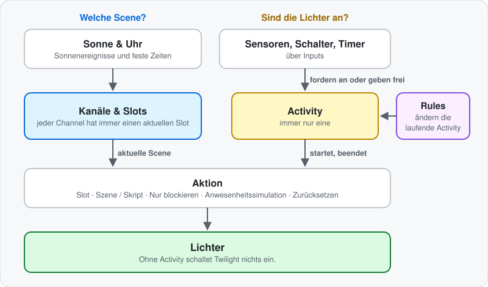

# So funktioniert Twilight

Das [LIESMICH](LIESMICH.md) erklärt jede Funktion für sich. Diese Seite zeigt, wie alles zusammenspielt: wer entscheidet, was deine Lichter tun, was Vorrang hat und warum sich ein Licht manchmal anders verhält als erwartet.

Fertige Setups findest du in den [Beispielkonfigurationen](BEISPIELE.md).

## Inhalt

- [Die Grundidee: Der Zeitplan wählt, eine Activity schaltet](#die-grundidee-der-zeitplan-wählt-eine-activity-schaltet)
- [Was eine Activity startet und beendet](#was-eine-activity-startet-und-beendet)
- [Immer nur eine Activity](#immer-nur-eine-activity)
- [Was beim Slot-Wechsel passiert](#was-beim-slot-wechsel-passiert)
- [Was Rules ändern](#was-rules-ändern)
- [Wenn jemand ein Licht direkt schaltet](#wenn-jemand-ein-licht-direkt-schaltet)
- [Nach einem Neustart](#nach-einem-neustart)

---

## Die Grundidee: Der Zeitplan wählt, eine Activity schaltet

  

Twilight trennt zwei Fragen:

- **Welche Scene?** Das beantworten die Slots. Jeder Channel hat immer einen aktuellen Slot, und Sonne oder Uhr schalten ihn weiter, egal ob ein Licht an ist oder nicht.
- **Sind die Lichter überhaupt an?** Das beantwortet eine Activity. Solange keine läuft, schaltet Twilight nichts ein. Ein Slot allein macht nie ein Licht an.

Ein typischer Abend im Wohnzimmer:

1. Es ist 19:00, der aktuelle Slot ist die Bürgerliche Abenddämmerung, die Lichter sind aus. Von selbst passiert nichts.
2. Du kommst herein. Der Motion-Input fordert die Motion-Activity an, und ihre Aktion **Slot** spielt sofort die Scene der Bürgerlichen Abenddämmerung.
3. Du bleibst. Die Nautische Abenddämmerung beginnt, und die eingeschalteten Lichter blenden zur neuen Scene über.
4. Du gehst. Der Timer läuft ab, und die Freigabeaktion **Ausschalten** macht die Lichter aus.
5. Die Slots laufen im Hintergrund weiter, und die nächste Bewegung spielt die Scene, die dann aktuell ist.

---

## Was eine Activity startet und beendet

Inputs fordern eine Activity immer nur an oder geben sie frei. Was mit den Lichtern passiert, entscheidet die Activity.

| Input | Fordert die Activity an | Gibt sie frei |
|---|---|---|
| **Bewegung** | Bei Bewegung, wenn die [Helligkeitsprüfung](LIESMICH.md#helligkeitsprüfung-für-bewegung) passt | Nie — ein ruhiger Melder sagt nichts über den Raum aus, also beendet der Timer die Activity |
| **Binär** | Beim Einschalten | Beim Ausschalten |
| **Ereignis** | Bei einem passenden Ereignis | Nie |
| **Timer** | Zu seiner täglichen Uhrzeit | Nie |
| **Button (Klick)** | Bei jedem Klick | Nie |
| **Button (Umschalten)** | Beim Einschalten | Beim Ausschalten |

Eine Activity endet auf einem dieser Wege:

| Was passiert | Ergebnis |
|---|---|
| **Der Timer läuft ab** | Twilight prüft zuerst, ob ein auslösender Input noch aktiv ist: ein Melder, der weiter an ist (und die Helligkeitsprüfung besteht), ein Binär-Input oder ein Umschalt-Button. Wenn ja, startet der Timer mit der vollen Dauer neu. Wenn nein, endet die Activity. |
| **Ein Binär-Input oder Umschalt-Button geht aus** | Die Activity endet, außer ein anderer ihrer Inputs hält sie noch. |
| **Eine andere Activity übernimmt** | Die Aktion der neuen Activity entscheidet, was die Lichter tun. Die Freigabeaktion der alten läuft nicht. |
| **Eine Reset-Activity läuft** | Alle Lichter des Bereichs und seiner aktivierten Channels gehen aus, dazu die **Ausschalt-Entitäten** der laufenden Activity. Mit **Nur Ausschalt-Entitäten** geht nur die eigene Liste des Resets aus. Danach läuft keine Activity mehr. |

Eine Activity ohne **Auto-Ablauf aktivieren** hat keinen Timer. Gestartet durch Bewegung, ein Ereignis, einen Timer oder einen Klick läuft sie, bis eine andere Activity übernimmt oder ein Reset sie beendet.

Endet eine Activity von selbst, entscheidet ihre **Freigabeaktion**, wie es weitergeht:

| Freigabeaktion | Lichter |
|---|---|
| **Ausschalten** | Gehen aus, mit **Ausschalt-Überblendung**, falls eingestellt. |
| **Zu Aktivität wechseln** | Die gewählte Activity übernimmt, als wäre sie gestartet worden, mit ihrer eigenen Aktion und ihrem Timer. Ihre Freigabeaktion entscheidet, was danach kommt. Lichter, die sie nicht steuert, bleiben, wie sie sind. |
| **Keine Lichtaktion** | Bleiben, wie sie sind, und folgen den Slots nicht mehr. |

---

## Immer nur eine Activity

Eine Area führt genau eine Activity aus. Eine neue Anfrage verdrängt die laufende — mit zwei Ausnahmen:

- **Eingangsunterdrückung:** Die laufende Activity kann bestimmte Inputs ignorieren, zum Beispiel eine Sleep-Activity die Bewegung. Der Input wird abgedunkelt angezeigt, und seine Anfragen bleiben ohne Wirkung. Andere Inputs kommen weiter durch.
- **Ein deaktivierter Input** löst nie aus, genauso wenig wie ein Input ohne Entity.

Eine neue Anfrage für **dieselbe** Activity ist ein frischer Befehl: Der Timer startet neu, und von Hand ausgeschaltete Lichter gehen wieder an.

Was *neben* einer Activity laufen soll, ist eine [Rule](#was-rules-ändern), keine zweite Activity.

---

## Was beim Slot-Wechsel passiert

  

Solange keine Scene aktiv ist, bewirkt ein Slot-Wechsel nichts. Sonst hängt es von der laufenden Activity ab:

| Aktion der Activity | Beim Slot-Wechsel |
|---|---|
| **Slot** | Der Channel wechselt zur Scene des neuen Slots. |
| **Szene / Skript** | Die feste Scene bleibt. |
| **Nur blockieren** | Nichts passiert. |
| **Anwesenheitssimulation** | Lichter, die eine simulierte Bewegung eingeschaltet hat, folgen dem neuen Slot. |

Bei der Aktion **Slot** hängt es davon ab, was im neuen Slot eingestellt ist:

- **Eine Standard-Scene:** Eingeschaltete Lichter blenden über die **Slot-Überblenddauer** zu ihr über. Ein einzelnes ausgeschaltetes Licht bleibt aus. Ist der ganze Channel aus, schaltet der neue Slot ihn wieder ein — außer du hast ihn von Hand ausgeschaltet und **Manuelles Aus respektieren** ist an.
- **Eine dynamische Hue-Scene oder ein Script:** Sie starten immer komplett, auch wenn einzelne Lichter aus sind. Eine dynamische Scene schaltet alle ihre Lichter ein, und ein Script tut, was in ihm steht.
- **Ein Channel, den du komplett von Hand ausgeschaltet hast,** bleibt bei jedem Slot-Wechsel dunkel, solange **Manuelles Aus respektieren** an ist, egal was der neue Slot enthält.
- **Ein Slot ohne Scene oder einer, der unter Kanäle / Slots abgewählt ist:** Der Channel geht aus. Ein abgewählter Slot startet seine Scene oder sein Script nie. Der Channel bleibt aus, bis der nächste Auslöser oder ein Slot der obigen Art kommt.

Jeder Channel folgt seinen eigenen Slots. Als Faustregel für Custom Channels: Der Baum **Kanäle / Slots** der Activity entscheidet, *ob* ein Channel spielt, seine Slots entscheiden, *was*.

---

## Was Rules ändern

Eine Rule ist ein zeitweiser Override für eine Activity. Sie wirkt, solange beides gilt:

1. Ihr Auslöser-Input ist aktiv (ein Binär-Input oder ein Umschalt-Button).
2. Ihre Ziel-Activity ist die, die gerade läuft.

Rules schalten nie selbst Lichter und starten keine Activity. Sie ändern, wie sich die laufende Activity verhält, und zwar sofort, ohne auf den nächsten Auslöser zu warten:

| Eine Rule kann ändern | Wirkung, solange sie gilt |
|---|---|
| **Kanäle / Slots** | Ersetzt die Auswahl der Activity für das, was die Rule auflistet. |
| **Auto-Ablauf-Verhalten** | Pausiert den Timer, setzt ihn aus oder startet ihn neu. |
| **Auto-Ablauf aktivieren** | Leiht einer Activity ohne Timer einen. |
| **Unterdrückte Eingänge** | Ersetzt die Eingangsunterdrückung der Activity. |
| **Manuelles Ausschalten** | Respektiert oder ignoriert von Hand ausgeschaltete Lichter, egal was an der Activity eingestellt ist. |

Es können beliebig viele Rules gleichzeitig gelten. Zielen mehrere auf dieselbe Activity, spielt ein Slot nur, wenn **alle** ihn angewählt haben („Exclude gewinnt“). Endet eine Rule, gelten wieder die Einstellungen der Activity.

---

## Wenn jemand ein Licht direkt schaltet

Twilight bemerkt Änderungen über einen Wandschalter, eine App oder einen Sprachassistenten, macht sie aber nicht rückgängig. So geht es weiter:

| Situation | Das Licht… |
|---|---|
| **Du dimmst ein Licht oder änderst die Farbe** | behält deine Änderung und erscheint in **Leuchten & Geräte** als Abweichung. Beim nächsten Slot-Wechsel oder Auslöser folgt es wieder der Scene. |
| **Du schaltest ein Licht aus** | wird als **Manuell aus** markiert. Bei normalen Slot-Wechseln bleibt es aus. |
| **Du schaltest alle Lichter eines Channels aus** | bleiben bei jedem Slot-Wechsel aus, wenn **Manuelles Aus respektieren** an ist, auch bei dynamischen Hue-Scenes. Ohne die Option schaltet der nächste Slot mit Licht sie wieder ein. |
| **Ein neuer Auslöser kommt** | geht wieder an. Ein Auslöser ist ein frischer Befehl, und die Markierung wird gelöscht. |
| **Die Activity endet** | wird wie alle anderen behandelt, und die Markierung ist weg. |

**Manuelles Aus respektieren** gilt bei Slot-Wechseln und wenn Twilight eine laufende Scene korrigiert: Markierte Lichter bleiben aus. Ausnahme: Eine Scene oder ein Script, das als Ganzes läuft, etwa eine dynamische Hue-Scene, schaltet sie mit ein — außer der ganze Channel ist von Hand aus, dann bleibt er dunkel.

**Eine Scene zu ändern,** in der Hue-App oder in Home Assistant, ist etwas anderes, als ein Licht zu ändern. Twilight liest die Scene neu ein, und läuft sie gerade, folgen ihre Lichter sofort. Ein Channel, dessen Lichter alle aus sind, bleibt aus.

**Direkt nachdem Twilight einen Befehl gesendet hat,** kann es ein Licht für ein paar Sekunden korrigieren, während es prüft, ob alles angekommen ist. Eine Änderung genau in diesem Moment kann überschrieben werden.

---

## Nach einem Neustart

- Der aktuelle Slot wird neu berechnet und passt damit immer zur Tageszeit. Der Start spielt keine Scene ab.
- Eine laufende Activity kommt mit ihrer Restzeit zurück. Ist ihr Timer abgelaufen, während Home Assistant aus war, endet sie sofort, und ihre Freigabeaktion läuft, **Ausschalten** macht die Lichter also aus.
- Eingeschaltete Lichter bleiben, wie sie sind, und folgen dem nächsten Slot-Wechsel. Lichter, die schon vor dem Neustart von Hand ausgeschaltet waren, bleiben aus, wenn **Manuelles Aus respektieren** an ist.
- Eine laufende Anwesenheitssimulation setzt sich von selbst fort und schaltet Lichter wie gewohnt.

Was Twilight gerade tut und warum, zeigen der [Live-Monitor und die anderen Karten](LIESMICH.md#die-area-ansicht-lesen). Für die Entscheidungen hinter einem einzelnen Ereignis schalte das [Debug-Logging](LIESMICH.md#debug-logging) ein.
